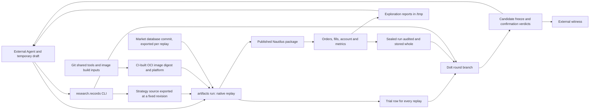

# Current Architecture

## Product form

External Agents research source material, propose hypotheses, edit versioned native Nautilus `Strategy` source, run a local replay and inspect its evidence. A strategy is a first class artifact. Persistent research data lives only in Dolt and its backup copy: each complete single-file strategy and its revisions, a trial row for every native replay, stored runs with their native reports, evidence bundles, candidate freezes and confirmations. Agents develop drafts in temporary directories and export a fixed Dolt revision for execution. Git maintains the Agent rules and skills, shared tools, image build inputs, tests and historical evidence. An immutable OCI image supplies Python, Nautilus, native replay and audit code. The published Nautilus package owns matching, orders, risk, execution, portfolio and account calculations.

The product has four layers, distinguished by where each guarantee comes from:

| Layer | Content | Location | Guarantee |
|---|---|---|---|
| 0 Always-on rules | User authority boundaries, when to write product code, no parallel engine, which skill to use when, paired replay for behavior-preserving changes | Root `AGENTS.md`, loaded automatically by most sessions | Guidance only; observed by layer-3 adversarial cases |
| 1 Skills | Method and exact commands for a research round (`research-round`); native report statistics (`nautilus-report-analysis`); video evidence and notes (`video-evidence`); loaded on demand | `.agents/skills/` | Guidance only; observed by layer-3 with/without-skill comparisons |
| 2 Contracts and execution | Research ledger accounts and refusals, product-computed freeze and confirmation verdicts, digest-pinned OCI image, published Nautilus, the video evidence checker | In place: `research/records`, `backtest`, the CI-built image, `services/video-evidence` | Insert-only accounts and server-time stamps make changes leave traces, not impossible; refusals prevent mistakes |
| 3 Evaluation | Skill case replay, `ledger audit`, external witness | Regression cases in `.agents/skills/*/evals/`; held-out cases and answer keys in a private directory outside Git; RFC 3161 timestamps of freeze and confirmation-plan commits from a public authority, stored in the ledger | Runs from, or is recorded in, a location the evaluated session does not control |

Layer 2 is not an unbypassable boundary. On this single-user host the Agent runs as the same operating-system user as Dolt and Docker, so it can read the service's root password, edit the data directory or host code, or build its own image. The guarantee is that changes leave traces, not that they are impossible. On the normal path the writer account can only insert, branch control limits it to the open round, triggers set `created_at` to server time, and concurrent writes conflict instead of merging. The product, not the Agent, computes freeze and confirmation verdicts from the goal's gates and the run's stored readings and counts distinct strategy sources from trial rows; freezes and confirmations accept only runs on CI images built on origin/main. `ledger audit` checks a whole round: commit tests, append-only history, stored readings against a recomputation, verdicts, trial counts and witnesses. Freeze and confirmation-plan commits get an RFC 3161 timestamp from a public authority, stored in the ledger and verified offline, a plan before its window starts, so a backdated plan shows against its token. A timestamp proves that a record existed by then, not that it was the only one. A record forged with root access in API form before its witness, or a replay started outside `artifacts run` that leaves no trial row, is not currently detectable. Only a separate custodial operating-system user would harden layer 2; that waits until the first passed confirmation or a conclusion that must rely on layer 2. See the [skill product-form audit](plans/skill-product-form-audit.zh.md). The video evidence checker `services/video-evidence/check_bundle.py` writes nothing, imports no repository code, recomputes hashes, frames, crops and the ASR input from the media bytes and checks citations. Research rounds run only the local checker; elsewhere an Agent can edit a local copy, so only a clean-context reviewer's run from `origin/main` with a matching `checker_git_blob` counts (see the [video evidence decision](plans/video-evidence-refactor.zh.md)).

R1 replays 37 contracts in one native 100,000 USDT margin account to expose capital competition within the strategy. Each independent strategy binds to its own fixed-capital native account. If several trading logics must share that capital, implement them as one composite Nautilus `Strategy` with one versioned source file and one account. That file contains the complete trading rules while genuinely shared runtime and data capabilities remain dependencies. Allocation, orders and exits are replayed together. For per-component attribution, the composite Strategy records a component identity with its orders and research evidence; native account equity remains the combined result. There is no external position ledger or parallel portfolio service.

`research.records` is the research domain interface for Agents: `python -m research.records.cli` and `research.records.artifacts`. Persistent research data lives only in Dolt and its `dolt_backup` copy; drafts, exploratory scripts, replay outputs and derived reports are working copies in `/tmp`, and Git holds no strategy bodies or experiment receipts. One Dolt service can host several databases: the research ledger now, market data later. Each goal is a round, the branch `round/<goal_id>` from `main`, which holds only the schema; the round is tagged `closed/<goal_id>` at the end. Typed tables hold the goal, evidence bundles, strategy revisions with their source bytes, trials, runs, freezes, confirmation plans and verdicts, and corrections. `ledger sql` reads any branch or tag as the reader account, and `ledger export` writes every table at a branch or tag as Parquet.

Every native replay goes through `artifacts run` and first writes a trial row with its source hash, window, coins and image. `--explore` replays a draft into a new `/tmp` directory and stores nothing else. `--strategy ID@N` replays a published revision in a temporary directory, audits it, stores the whole run in Dolt in one write and deletes the directory: product readings as columns of `run`, native reports as `run_order`, `run_fill`, `run_position`, `run_account`, `run_return` and `run_order_event` rows, and exposures as a compressed blob. A run whose audit fails is stored as `invalid` with its reasons. Agents compute other statistics from a stored run following the `nautilus-report-analysis` skill.

Only two research records are registered; everything else is exploration. A candidate freeze cites one sealed run of a fixed revision on the goal's development window and is written once. The product computes its verdict (`passed`, `failed` or `invalid`) from the goal's gates and the run's readings and counts the distinct strategy sources from trial rows; the Agent names the failed part. A confirmation follows a passed freeze: its plan preregisters a future window and is timestamped by an RFC 3161 authority before the window starts, and after the window one sealed run receives a product-computed verdict. A verdict is never edited; a correction is a new record naming it. Freezes and confirmations accept only runs on CI images built on origin/main and are refused from a checkout that lacks origin/main.

The writer account has `SELECT` and `INSERT`, `UPDATE` only on `ledger_head` and `EXECUTE` only on the procedure `dolt_commit`; the reader account only selects; branch control limits the writer to the open round. Every write is one transaction that also updates the single `ledger_head` row, so a later concurrent writer gets error 1213 instead of a merge. Reads do not revalidate the ledger; `ledger audit` is the full check. Old ledgers and sealed artifact directories are outside this design and are deleted in WS7. The [`research-round` skill](../.agents/skills/research-round/SKILL.md) gives the operating steps; the [record guide](../research/records/README.md) covers the service, accounts, write protocol, backup and tests.

## Current runnable slice

Every native replay goes through `research.records.artifacts run`: `--explore` writes a draft's reports to a new `/tmp` directory, a sealed run is stored in the ledger, and both write one trial row. It executes `python -m backtest.run` and the auditor in an image CI builds for `linux/arm64` and pushes to `ghcr.io/qoeop/trade-runtime`, labelled with its source commit; without `--runtime` it pulls the `main` tag and records the digest, and freezes and confirmations accept only images built from a commit on origin/main. The runner uses the published `BacktestNode` pinned to `nautilus_trader==2.0.0rc3` and takes four things: the strategy reference, the inputs, the window and the fixed account. The current `r1-native-v5` contract loads one complete source file; the source owns its signals, sizing, native orders, exits and diagnostics, and the runner has no strategy parameter, so a variant is a new revision. Only the `r1-native-v5` layout is known to current code; seals of `v1` to `v3` are not read. The inputs are one commit of the market database (`research/market`: 1-minute LAST and MARK bars, funding and terms of every contract the monthly top-50 pool held since 2020-01, from Binance public archives and REST); `artifacts run` exports the commit into one Catalog per contract with every timeframe derived from the 1-minute bars, and each strategy instance receives its contract's pool membership. Nautilus loads the bars, MARK updates and funding and performs settlement; `backtest/load.py` checks each export against the commit and window, `backtest/run.py` builds the Node and `backtest/report.py` writes the reports. See `backtest/README.md` for usage and paired acceptance, and the [paired replay](plans/nautilus-upstream-poc.md) for historical evidence.

The pinned `nautilus_trader==2.0.0rc3` is the version whose orders and economics were paired on the same data, parameters and shared account; an upgrade must recheck native order integrity and the annual pairing. Current contract metadata comes from the rule assumptions saved during research and does not prove precise historical daily contract terms. Market data stays in its Dolt database and is not copied into Git. Research scripts and exposed annual results can serve mechanism diagnosis; confirming a new candidate needs independent preregistered rules, pairing and out-of-sample or multiple-attempt handling.

## Extension boundaries

Strategy version management is the ledger's `strategy_revision` table: append-only revisions with exact source bytes. Each independent strategy has one complete source file. A revision keeps its strategy ID; a derived strategy gets a new ID, a fixed parent revision and an explicit difference. Shared replay, validation and acceptance tools live in `backtest/` and the CI-built image; product Git receives no strategy drafts.

The research ledger holds real research records: clearing, resetting or rewriting it, its rounds or its backup requires explicit user authority. The ledgers, sealed directories and backups from before the 2026-10-11 rewrite are not read by current code; WS7 deletes them, and the [ledger enablement record](plans/ws2-ledger-enablement.zh.md) states what earlier rounds exposed.

Full replay recovery needs the ledger (its `dolt_backup` copy holds every branch and tag, so source, configuration, input identity and native reports together), the exact OCI image (pull its digest from GHCR) and the market commit (a new export gives the same Catalogs). A backup in a second local directory does not prove recovery across independent failure domains; recovery on another host remains to be accepted. Nautilus continues to own trading facts. Live trading is a separate future delivery requiring user authorization and acceptance of its boundaries.
