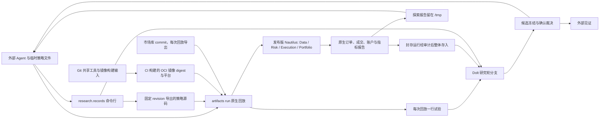

# Trade 当前架构

## 产品形态

外部 Agent 直接研究市场资料、提出假设、编辑版本化 Nautilus `Strategy` 源码、调用本地回放入口并阅读证据。策略是第一等公民。持久研究数据只存在 Dolt 及其备份副本中：每个策略的完整单文件源码与版本、每次原生回放的试验行、连同原生报告一起保存的运行、证据包、候选冻结与确认。Agent 在临时目录开发，发表后从固定 Dolt revision 导出执行文件。Git 维护 Agent 规则与 skill、共享工具、镜像构建输入、测试和历史证据；固定 OCI 镜像提供 Python、Nautilus、原生回放与审计环境。撮合、风控执行、订单生命周期、组合与账户计算由发布版 Nautilus 提供。

产品分四层，按保证从哪里来区分：

| 层 | 内容 | 位置 | 保证来自 |
|---|---|---|---|
| 0 常驻规则 | 用户授权边界、何时写产品代码、不另造引擎、何时用哪个 skill、行为不变的改动先做配对重放 | 根 `AGENTS.md`，多数会话自动加载 | 只是提示；由第 3 层的对抗用例观察 |
| 1 skill | 一轮研究的方法与确切命令（`research-round`），原生报告统计规则（`nautilus-report-analysis`），视频取证与笔记（`video-evidence`），按需加载 | `.agents/skills/` | 只是提示；由第 3 层的有/无 skill 对照观察 |
| 2 契约与执行 | 研究台账的账户与拒绝、由产品计算的冻结与确认裁决、固定 digest 的 OCI 镜像、发布版 Nautilus、视频证据包检查器 | 原地：`research/records`、`backtest`、CI 构建的镜像、`services/video-evidence` | 只能插入的账户与服务器时间戳让改动留下痕迹，但不能阻止；拒绝只防误操作 |
| 3 评估 | skill 案例重放、`ledger audit`、外部见证 | 回归用例在 `.agents/skills/*/evals/`；留出用例与答案键放 Git 外的私有目录；冻结与确认计划提交的 RFC 3161 时间戳来自公共时间戳机构，存在台账里 | 在不受被测会话控制的位置执行或留档 |

第 2 层不是无法绕过的边界。本机只有一个用户，Agent 与 Dolt 和 Docker 同属一个操作系统用户，能读到服务的 root 密码、改数据目录或宿主代码，也能自建镜像。保证是改动留下痕迹，而不是改动做不到。正常路径上，写入账户只能插入，分支控制把它限制在当前开着的一轮，触发器把 `created_at` 设为服务器时间，并发写入会冲突而不是合并。冻结与确认的裁决由产品而不是 Agent 根据目标闸门和运行已存的读数计算，不同策略源码数从试验行统计；冻结与确认只接受 origin/main 上构建的 CI 镜像所跑的运行。`ledger audit` 检查整轮：提交测试、只追加的历史、已存读数与重算的比对、裁决、试验计数和见证。冻结与确认计划的提交向公共时间戳机构申请 RFC 3161 时间戳，凭证存进台账、离线验证；计划在其窗口开始前盖戳，所以倒填日期的计划会与凭证对不上。时间戳只证明记录在那时已经存在，不证明它是唯一的一份。用 root 权限在见证之前以 API 形态伪造的记录、绕过 `artifacts run` 启动而不留试验行的回放，目前都发现不了。只有独立的托管系统用户能让第 2 层变硬，等出现第一个通过的确认或必须依赖第 2 层的结论时再做，见 [skill 产品形态审计](plans/skill-product-form-audit.zh.md)。视频证据包检查器 `services/video-evidence/check_bundle.py` 只读、不导入仓库代码，从媒体字节重算哈希、帧、裁剪与 ASR 输入，并核对引用。研究轮只运行本地检查器；其他场合 Agent 能改本地副本，所以只有干净上下文的审阅者从 `origin/main` 运行、`checker_git_blob` 一致的那次检查算数，见[视频取证改造](plans/video-evidence-refactor.zh.md)。

R1 当前的 37 个合约在**同一个**初始 100,000 USDT 的原生保证金账户内回放，才能观察同一策略的资金占用与跨币竞争。独立策略各绑定一个固定金额的原生账户。需要多个交易逻辑共同分配这笔资金时，将它们实现为**一个组合 Strategy**：一个版本化策略文件，在同一原生账户内做分配、下单与退出，并整体回测。策略文件包含完整交易规则；真正通用的运行与数据能力通过依赖复用。若需要逐子逻辑归因，组合 Strategy 应在自身订单与研究证据里保留子逻辑标识；原生账户净值仍以整个组合为准。当前不增加外置仓位账本或组合服务。

`research.records` 是 Agent 使用的研究领域接口：`python -m research.records.cli` 与 `research.records.artifacts`。持久研究数据只存在 Dolt 及其 `dolt_backup` 副本中；草稿、探索脚本、回放输出和派生报告是 `/tmp` 里的工作副本，Git 不保存策略正文或实验凭证。一个 Dolt 服务可以承载多个数据库：现在是研究台账，以后还有行情数据。每个目标是一轮研究，即从 `main` 分出的分支 `round/<goal_id>`，`main` 只放 schema；一轮结束时打上标签 `closed/<goal_id>`。类型化的表保存目标、证据包、带源码字节的策略修订、试验、运行、冻结、确认计划与裁决，以及更正。`ledger sql` 以只读账户读取任意分支或标签，`ledger export` 把某个分支或标签上的全部表写成 Parquet。

所有原生回放都走 `artifacts run`，启动前先写一行试验，记录源码哈希、窗口、币种和镜像。`--explore` 把草稿回放到新的 `/tmp` 目录，除此之外不存任何东西。`--strategy ID@N` 在临时目录回放已发表的修订，审计后一次写入把整个运行存进 Dolt，然后删除目录：产品读数是 `run` 的列，原生报告是 `run_order`、`run_fill`、`run_position`、`run_account`、`run_return` 与 `run_order_event` 的行，敞口是一个压缩 blob。审计不通过的运行连同原因存为 `invalid`。其他统计由 Agent 依 `nautilus-report-analysis` skill 从已存运行计算。

研究记录只登记两种，其余都是探索。候选冻结引用某个固定修订在目标开发窗口上的一次封存运行，只写一次。裁决（`passed`、`failed` 或 `invalid`）由产品根据目标闸门和运行读数计算，不同策略源码数从试验行统计；失败部位由 Agent 指明。确认跟在通过的冻结之后：计划预登记一个未来窗口，并在窗口开始前取得 RFC 3161 时间戳；窗口结束后，一次封存运行得到产品计算的裁决。裁决从不修改，更正是指向它的新记录。冻结与确认只接受 origin/main 上构建的 CI 镜像所跑的运行，缺少 origin/main 的检出会被拒绝。

写入账户有 `SELECT` 和 `INSERT`，`UPDATE` 只限 `ledger_head`，`EXECUTE` 只限存储过程 `dolt_commit`；只读账户只能查询；分支控制把写入账户限制在当前开着的一轮。每次写入是一个事务，同时更新唯一的 `ledger_head` 行，所以并发时后到的写入得到错误 1213，而不是被合并。读取不重新校验台账，完整检查是 `ledger audit`。旧台账和封存产物目录不在本设计内，在 WS7 删除。操作步骤见 [`research-round` skill](../.agents/skills/research-round/SKILL.md)；服务、账户、写入协议、备份和测试见[研究记录指南](../research/records/README.md)。

## 当前可运行切片

所有原生回放都走 `research.records.artifacts run`：`--explore` 把草稿的报告写进新的 `/tmp` 目录，封存的运行存进台账，两者都写一行试验。它在 CI 构建的镜像里执行 `python -m backtest.run` 和审计器；镜像只构建 `linux/arm64`，推到 `ghcr.io/qoeop/trade-runtime`，标签里带源码 commit。不传 `--runtime` 时拉取 `main` 标签并记录 digest；冻结与确认只接受由 origin/main 上的 commit 构建的镜像。运行器使用锁定在 `nautilus_trader==2.0.0rc3` 的原生 `BacktestNode`，只接收四样东西：策略引用、输入、窗口和固定账户。当前 `r1-native-v5` 加载一个完整源码文件；策略文件负责信号、仓位、下单、退出和自身诊断，运行器没有任何策略参数，变体就是新的修订。现行代码只认 `r1-native-v5` 的布局，不再读取 `v1` 到 `v3` 的封存。输入是市场库的一个 commit（`research/market`：自 2020-01 起、每月前 50 币池进入过的全部合约的 1 分钟 LAST 和 MARK、资金费和合约条款，来自币安公开归档和 REST）；`artifacts run` 把它导出成每个合约一个 Catalog，各周期都由 1 分钟派生，每个策略实例拿到自己合约的币池成员资格。K 线、MARK 更新和资金费由 Nautilus 加载并结算；`backtest/load.py` 核对每个导出与 commit 和窗口一致，`backtest/run.py` 构建 Node，`backtest/report.py` 写报告。运行方式和配对验收见 `backtest/README.md`，历史证据见 `docs/plans/nautilus-upstream-poc.zh.md`。

固定版本为 `nautilus_trader==2.0.0rc3`。这是在同一数据、同一参数、同一共享账户上通过订单与经济结果配对的版本；升级前必须重新检查原生订单完整性及全年配对。当前合约元数据来自研究时保存的现行规则假设，不能据此声称历史逐日合约条款精确。市场数据存在它的 Dolt 库里，不复制进 Git。研究脚本与已暴露年度结果可用于机制诊断；新候选的确认需独立的事前规则、配对与样本外/多重尝试处理。

## 扩展边界

策略版本管理就是台账的 `strategy_revision` 表：只追加的修订，保存精确源码字节。一个独立策略对应一个完整源码文件；同一策略的新修订沿用同一个 ID，衍生策略使用新 ID，指向父策略的固定修订并注明差异。公共回放、校验和验收工具归 `backtest/` 与 CI 构建的镜像，产品 Git 不收策略草稿。

研究台账承载真实研究记录：清空、重置或改写它、它的轮次或备份，都需要用户明确授权。2026-10-11 重写之前的旧台账、封存目录和备份不再被现行代码读取，由 WS7 删除；早先各轮暴露过什么，见[新库启用记录](plans/ws2-ledger-enablement.zh.md)。

完整回放恢复需要台账（它的 `dolt_backup` 副本含全部分支和标签，源码、配置、输入身份和原生报告都在里面）、精确的 OCI 镜像（按 digest 从 GHCR 拉取）和市场库里那个 commit（重新导出即得同样的 Catalog）。本机第二目录的备份不代表独立故障域灾备，异机恢复尚待验收。Nautilus 继续负责交易事实；实盘连接是后续独立交付，须另行取得用户授权并验收边界。
