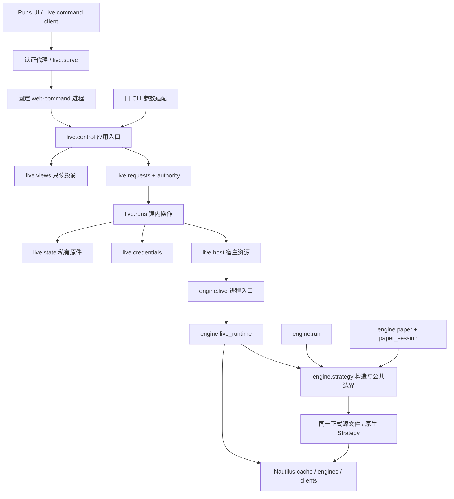

# Live 模块化与统一策略源码正式设计

日期：2026-11-08。状态：正式架构设计 v3；R 与 U1 的设计准入已获双复审，U2 仍有明确前置门；冻结稿与两份独立复审结论见[评审记录](https://github.com/qOeOp/trade/blob/cc56fccbe7654401dfdb5906db74da03b8901f25/docs/plans/live-modularization-design-review-20261108.zh.md)。产品基线 `1a0482263`；交易引擎锁定 `nautilus_trader==2.0.0rc7`。本轮只形成设计及离线证据，不实施产品、源码检查、账户、部署或真实连接变更。GTD 的历史失败继续保留，不阻塞本设计及无行为变化的模块整理。

## 1. 目标、范围与完成定义

要交付的是：一个正式策略版本的一份完整 Python 源码、一个 entry class、一个 source hash，经过三种模式各自的显式能力与执行契约运行；Web/CLI 使用同一 Live 应用逻辑；接入代码按职责维护，新增策略无需复制 Live runner。不是把不同成交模型或账户经济强行变成相同，也不保证任意 Nautilus Strategy 不经能力验证即可实盘。

分两条实施轨道，不能混成一次“重构”：

- **R：保持行为的模块化。** 保持 v7/现有 Live 格式、拒绝码、边界条件、调用顺序、历史、凭据及发布协议。先实施，不依赖 GTD 自然到期通过。
- **U：正式单源码契约与两份 Retest 的迁移。** 新策略版本、必要的新 runtime contract、明确的异步与数据行为；单独验证、授权后实施。不是将现有约 32% 的研究收益转贴到适配版。

第一批只做单账户、单策略、单品种。每轮一次 LIMIT 入场、只对账不恢复交易、账户独占等现行限制，在 R 中完全保留。在 U 中仍能完成“一份源码在三种模式的同一受限场景运行”；**多次循环入场和多策略并发不是这个受限验收的自动结果**，单策略连续多次交易列为正常 Live 产品完成前必需的 U4；多策略并发另立扩展范围。不能把受限三模式通过称为通用 Live 平台完成。

完成条件：R 全部适用回归及固定镜像成对回放通过；U 同 hash/class/策略参数在三模式身份一致、数据与异步用例通过，正式自然信号执行有单独证据；UI 显示实际源码与模式限制；旧运行仍能查询、STOP、对账。没有交付“模块化”却留下两套新旧写路径，也没有用同名、不同内容的源码冒充统一。

## 2. 当前事实与要解决的结构问题

| 当前 owner | 已有能力 | 当前问题 / 决定 |
| --- | --- | --- |
| `engine/load.py` | 完整源码哈希校验、reach 检查、原生类解析 | 保留一个加载器；不重写成策略 DSL，不靠 AST 推断全部运行能力 |
| `engine/run.py:allocate_strategy`、三种 `_Configured` | 原生 `__new__` 与初始化参数正确转发 | 共用构造已修复，但 Paper/Live 依赖整个 replay 模块；抽出真正共有部分 |
| `engine/run.py` callbacks/cache/clock guards | 输入 cutoff、错误记录、只读 cache | 属于信任/证据边界；不可为“薄封装”移除 |
| `engine/paper.py` | 原生 Sandbox、cadence、100ms hold、检查点衔接 | 数据与生命周期混合；100ms 不是完成屏障，R 原样保留，U 单独验证替换 |
| `engine/live.py` | 会话、账户观察、命令约束、源码包装、Observer、节点、进程收尾 | 一个文件横跨多种职责；拆分所有权，不新增订单状态机 |
| `live/control.py` / `live/runs.py` | Web 用例、旧 CLI、账户锁、Docker、准备与回收 | Web 调多个私有函数，旧 CLI 走另一组合；提炼同一锁内应用操作及明确宿主端口 |
| `live/requests.py` / `credentials.py` / `authority.py` / `release.py` | 防重复、凭据版本、唯一账户 root、成对发布 | 已有模块继续使用；不再套第二层请求账本、凭据库或占用状态 |
| Runs 的 stage/driver/Live DTO 与 view | 已融入 Runs，准备 stepper 和凭据弹窗 | 统一“选择与布局”，保留三种模式事实差异，不把 Live 事件伪装成 Paper 权益 |

实际旧 GTD 运行使用 `ControlledPassiveEntry`，长时闭环使用 `ControlledTimedObservation`，均不是原研究源的三模式同文件验证。现有 `source_for_run` 拒绝 bracket/order list/DAILY_WARMUP、命令层限制一次入场；这些是产品边界，不能统称 Nautilus 不支持。

## 3. 原生能力与产品职责

证据细节、源码路径和可复用测试见[证据矩阵](live-modularization-native-evidence-20261108.zh.md)。以 rc7 tag 和已安装 Python API 为准；Context7 的 develop/rc8 结果仅定位，不作为 rc7 能力证明。

| 职责 | 所有者与设计选择 |
| --- | --- |
| 订单、成交、持仓、组合、费用与原生风险 | Nautilus；运行读其 cache/report，禁止平行订单表和自算持仓账本 |
| Replay 撮合 / Paper 撮合 / 实盘执行 | BacktestEngine / LiveNode+SandboxExecutionClient / LiveNode+BinanceExecutionClient；保留三种原生组装 |
| 原生配置、ID、GTD、减仓、关联持仓 | StrategyConfig/OrderFactory/原生 adapter；不重写 UUID、GTD scheduler、close 算法 |
| 实际账户双向与策略 NETTING | 不同层次；保留 adapter HEDGING + 策略 NETTING + 原生归属；账户独占不能被“已经双向”替代 |
| 成交保护 | 优先原生订单、事件和 cache；rc7 有原生 contingent manager 与 OrderEmulator；Binance Futures adapter 的 linked order-list 路径拒绝关联单，现产品又有独立命令限制。先核对原生管理/仿真路径，不能将产品拒绝误称框架缺能力，也不由 runner 自动拆 bracket |
| 数据请求、聚合、时钟和消息分发 | 优先原生 API；没有证据时不假定全局 FIFO、同步下单、100ms 屏障或 Rust API 已暴露到 Python |
| 恢复 | 原生 cache、on_save/on_load、reconciliation；产品仍验证原件、固定身份、可恢复范围。原生重连不是产品“恢复已验收”信号 |
| 操作请求、凭据版本、主机身份、占用与发布 | 产品；不是原生订单事实，继续原私有文件/锁/历史机制 |
| UI | 派生展示，明确观察时间/缺失/未知；不决定服务器权限和交易终态 |

### 3.1 新增自有机制的必要性门槛

用户明确要求：**已有框架机制一律优先使用；提出自有实现必须先证明锁定版本没有满足该需求的对应机制。** “没找到”、Python 顶层没有同名方法、当前产品拒绝或一个用例失败，都不构成不存在的证明。

每个拟新增机制必须在设计证据表列明：具体需求和消费者；rc7 文档、配置入口、Python 桥接、核心调用链及原生测试；最小原生实验的成功与失败原件；阻碍究竟属于框架缺口、venue 能力、产品准入或接入错误；为何不能通过原配置/组合解决；自有代码最小范围。未查清则不批准该自有机制，继续原生探针，也不阻塞无关 R 拆分。现有自有实现不因已存在就获得豁免；R 先保持行为，U 再按证据决定删减，不能未经验证顺手移除。

已决定复用：历史请求用原生 Catalog 配置和 request/callback；时钟/GTD 用原生 clock；配置/身份用 StrategyConfig；订单与保护优先原生 contingent/emulation 能力；诊断用原生日志。网页认证、凭据私有版本、跨进程请求和主机发布的消费者在 Nautilus 交易内核之外，保留既有产品边界，不据此另造交易状态。

现有 Live 的 USDT 准入、额度、保护覆盖及亏损停止仍是产品边界；原生下单风险不替代它们。全仓账户下阈值不等于最大损失。保留真实凭据隔离与最小权限，Nautilus 不承担网页凭据保存。

## 4. 模块划分与依赖

### 4.1 Runtime

目标文件名是职责安排，不是必须逐个空建文件：

- `engine/strategy.py`：从 run 抽出 `allocate_strategy`、公共 callback guard、受限 cache/clock 接口、运行内诊断收集。只消费原生对象与显式输入，不导入 Live/Paper/ledger/host。先保持本进程级上下文，不同时引入实例级隔离或改变事件排序。一次迁移全部 `FAILURE_PATH` 赋值、`FAILURES`/`STRATEGIES` 读写方到同一 owner；普通变量 re-export 无法代理旧模块属性赋值，禁止假兼容。旧 shim 只转发函数。动态类注册名、`__module__` 与原生 ImportableStrategy 的解析路径保持兼容，删除 shim 前验证全部内部调用已迁移。
- `engine/live_runtime/session.py`：现 Session 的运行内状态与事件输出；保持原字段/事件/写入顺序。不持久化第二份状态，不持有第二套订单集合。
- `engine/live_runtime/commands.py`：现 pending entry、账户观察结果消费、归属/金额/数量/连接检查与 native dispatch。future 只返回不可变 snapshot，不在线程里访问 native cache；native 主线程完成最后复核。取消 pending intent 不伪造 OrderCanceled。
- `engine/live_runtime/lifecycle.py`：现 Observer、STOP、断线、保护/损失触发与 native 退出、source_outcome。订单与持仓仍取 native cache。
- `engine/live_runtime/source.py`：现 `_LiveConfigured`、LiveClock 和 mode callbacks。显式组合公共 guard 与 Live 命令/生命周期策略，只有一个公共构造入口；禁止互相继承三种 runner。
- `engine/live_runtime/node.py`：现 Binance/LiveNode builder 与原生配置核对。Paper/Replay 保持各自 builder；只共享确实相同的原生配置值，不做吞所有参数的 GenericRunner。
- `engine/live.py`：保留 `python -m engine.live`、manifest读取、cache进程上下文与 execute/finally 边界，调用上述模块。旧 runtime 镜像继续包含旧布局。
- `engine/live_venue.py`、`live_cache.py`、`paper_session.py`、`paper_checkpoint.py` 已有专责不重建；Paper 的 cadence/hold 可以独立成 `paper_data.py`，但不得复制成一套新调度器。

Session 与模块通过已存在的会话/原生 handle 显式传参。无依赖注入容器、插件扫描、服务定位器或可执行配置。只有真实外部副作用（host、私有存储、venue snapshot）保留窄测试接缝。

### 4.2 Host / Web / CLI

- 保留 `live.control` 为应用入口，不另建同职责 `service`。抽出命名的 prepare/preflight/start/stop/reconcile/maintain 锁内操作；Web 和旧 CLI 调用相同操作，而非各自复制动作序列。
- `live.runs` 保留 manifest、冻结身份、生命周期与占用的应用操作；Docker argv、inspect、网络/容器完整身份、日志取得移到 `live.host`。host 不判断预算、凭据版本是否可换或请求是否可重放。
- 锁只有原 `Authority.serialized` / state 锁。Web 请求仍由 `requests.dispatch` **先登记意图，再执行副作用**；锁内操作不重复拿锁。旧 CLI 的既有无 request_id 路径保留原 `require_clear` 与 authority 检查，不自动伪造新请求 ID/历史；统一到相同命令执行核心不等于强制改变旧 wire 格式。
- 请求未知时不重试启动/连接，恢复只检查原操作。重复 ID 的 source/credential/runtime 取首次冻结声明，不读“今天最新”替换。STOP 和既有查询保留独立可用性。
- `observe` 是只读；旧内部 `status(maintain=True)` 有回收效果，拆成明确查询/维护入口并保留兼容调用的原行为。CLI 当前 `status` 分派至 `observe`，不得因重构变成隐式回收。
- 保留控制服务私有 socket、认证代理与固定命令子进程隔离，不将浏览器参数开放成 Docker argv、文件路径或任意 Python。
- 发布继续使用既有 runtime 输入配对、唯一 root、版本绑定、活动/未决延后与账户锁等待；不新建发布协调器。抽取必须纳入原 runtime 构建输入 fingerprint，不能新文件漏进镜像身份计算。

### 4.3 Runs 与凭据

沿用现 `RunStages`、`RunDriver`、`liveWorkspace`、`liveTradingCommands`、DTO→view model。将三种选择表达为仅内存的带 mode 分支身份；不强行把 Paper 数字 ID 转成 Live ID，不新增数据库全局 run 表。保留现持久导航格式的兼容读法。

组件只接收 view+actions；行情/事件/API 查询由各 mode owner 持有。复用 Identity、Details 容器、stepper、确认弹窗、错误/陈旧状态与现设计 tokens；原生 Live 观察缺少权益序列时继续明确缺失。读页面或切换模式绝不产生 POST；离开 Live 时停止无用订阅，不抹掉未决请求身份。

凭据仍存服务器私有版本文件。输入只在凭据弹窗临时状态，关闭/提交即清理；request journal 不含 key/secret，运行绑定旧版本不随“当前选中凭据”改变。研究 ledger、DoltHub、源码与 URL 不放秘密。浏览器仅保留现有安全的 pending request 身份，刷新只查询。

## 5. 单一策略源码的精确合同

### 5.1 身份与发布

策略版本与三模式比较基线是 **完整 source hash + entry class + 同值业务参数 + runtime contract**。业务参数包括信号、数量、保护与持有规则；同文件切到 Controlled 类不算同一策略。初始两份正式策略仍各一文件，不把 midepisode 与 mid3r 合成环境分支。

可重现的执行身份另按现运行记录冻结：runtime image、native StrategyId/TraderId/account、模式组装、输入与运行边界。它们可以因 run 或模式不同，不为比较而复用真实运行身份。比较时列清允许不同的环境绑定；OMS、GTD 管理、保护等影响语义的原生配置不能归为任意可不同项，不得通过模式分支暗改业务参数。这里不增加持久字段。

候选源码仍通过既有研究 CLI 注册到 ledger；准备 Live 时解析固定 research commit 中的候选源码，经现部署来源 allowlist 和审阅后冻结到私有 run inputs。Web 显示的 origin candidate 和实际 source hash 均保留；来源不同必须显式展示，不能隐藏为“统一版本”。不读取任意 IDE 编辑缓冲区直接实盘。

不新增 `is_live_compatible`、`portable=true` 等持久事实。能力结果由固定 source/runtime、当前准入逻辑和测试证据派生；现 runtime/source身份、request与凭据版本已足够。将来确需新的事实字段，先独立审查 consumer 与不可推导性，再单列迁移，不能借本设计默认授权。

### 5.2 构造与数据

R 保留现 v7 构造参数和所有行为。U 采用新 runtime contract（下称 v8 候选；版本名以实施时未占用值为准），旧源仍由旧固定 runtime 解释，不靠捕获 TypeError 猜构造器。

新合同继续是原生 `Strategy`，参数是原生 InstrumentId/StrategyId/Bar 等对象和运行边界，策略通过原生 `Strategy.__new__(..., StrategyConfig(...))` 分配。内部输入值对象仅用于消除三处参数转换；不存入新 ledger 表、不自制 StrategyConfig、不生成源码。

首批 Retest 所需的统一输入：闭合 1m 执行 bars、闭合 15m 信号 bars、80 根相邻 15m warmup、成员有效期。正式信号不依赖受控测试的主动触发；若选定正式源码要求 quotes，就必须提供真实 quote 数据，不能用 OHLC 伪造盘口。

**预热选择：三个模式均由同一源码调用原生 `request_bars`，消费原生 `on_historical_bars`。** 不新增 `historical_bars` 构造参数，也不自建历史分发、历史完成回调或行情追赶缓冲。Replay 使用 `BacktestEngineConfig(catalogs=[DataCatalogConfig(...)])`，由 kernel 注册原生 Catalog，DataEngine 原生服务请求；Paper/Live 使用现有原生 data client。Replay Catalog 是声明输入范围内可再生的只读缓存，无网络 fallback。覆盖不足在运行准备时失败，不能把 BacktestDataClient 没有历史抓取误判为 Catalog 功能不存在。

首批时间协议如下，P=15m、δ=1ms；此协议属于新正式候选，不原地修改旧源：

| 项目 | 冻结决定 |
| --- | --- |
| T 与启动 | 源从 native clock 取启动时间，向上对齐 15m 边界 T；正好在边界则取本边界。Replay 显式 `engine.run(start=T)`，Paper/Live 用原生 timer 等 T。不从 wall clock 或 mode 判断信号 |
| 请求 | T 发一次历史请求，`start=T−81P`、`end=T−δ`、`limit=81`，原生 15m EXTERNAL BarType；只取截至 T 前的已闭合 bars |
| Catalog 覆盖 | 准备时要求请求区间完全被真实输入覆盖；本轮探针以82根 `T−81P−δ ... T−δ` 满足原生范围判断，返回81根。较早那根是实际输入，不伪造端点；区间内不得缺数据。不能只检查文件存在 |
| 有效预热 | 响应返回后验证精确时间集合，最后80根必须为 `T−79P−δ ... T−δ`，即最后一根关闭于 T−δ。全为原生 Bar，时间均不晚于 native clock；不使用 T 后数据补足 |
| 就绪期限 | 必须在 native clock 严格小于 T+30s 时完成有效历史响应；在边界或之后统一停止本轮，无论 timer 与 response 谁先到。不补跑历史信号、不重试请求 |
| 首根交易数据 | 1m 为 T+60s−δ，15m 为 T+P−δ；T 前到达的实时数据只按当前启动窗口忽略，不产生决策。有效历史就绪后才允许业务决策 |
| 缺失/重复/交错 | 错误类型、响应缺根、重复/乱序历史、未来数据均失败；完整响应消费一次后相同完成回调忽略，矛盾响应失败。期限后响应不重开业务；实时序列缺失/重复/倒序依新合同失败，不自行修复。跨类型同刻事件见下文 |

上表预热精确集合的简式为 `{T−kP−δ | k=0..79}`，按时间升序。这不是“80根输入足够覆盖请求端点”：原生请求覆盖与最终信号所需80根是两个检查。源只维护信号指标与已消费截止时间，不复制原生历史请求状态机；一次请求身份由原生 request ID 与回调关联。

本轮 rc7 原生探针已验证 `run(start=T)` 的 on_start 时钟、Catalog 配置、81根响应、最后80根精确窗口和 history 先于实时回调。此前两个覆盖不足探针失败原件保留。还需以相同正式候选验证 T+29s/30s/31s、缺根/重复、未完成响应等负例；最小成功不替代完整策略验证。

历史与实时15m均约定交易所闭合时间 `bucket_end−1ms`。Replay 用既有1m输入生成可再生15m原生Bar缓存，保留原市场输入身份和转换版本；不改 canonical market。优先使用原生聚合，须证明其输出与所需交易所边界一致；若不一致先查原生配置，未证明缺能力不新增自有聚合器。不能把 INTERNAL/EXTERNAL 仅改名宣称等价，逐根核对 OHLCV、ts_event、ts_init。正式源中15m只更新信号状态；每个15m关闭时刻的同刻1m明确不允许新入场判定，两种到达顺序均跳过该次入场判定，从下一根1m起消费新信号。已有持仓保护由原生订单事件继续处理，不随这个跳过规则停用；不得回放同刻旧1m追赶入场。该因果选择属于新候选，须重跑研究。数据出口/检查变化归 U，不在 R 偷换。

### 5.3 交易与异步

正式源码通过原生订单事件/持仓事件推进交易，不把 `submit_order()` 返回当成接受/成交，也不依赖“on_bar返回前cache已出现持仓”。策略的信号计划、保护距离、目标、持有时间与数量仍在源文件中；订单事实只读native cache，不复制订单/持仓状态机。

- 撤回 v1 先选自主管理独立保护单的结论。**关联单的分发、部分成交数量联动与 sibling 撤销，先复用原生 OrderEmulator / OrderManager / manage_contingent_orders；本设计不批准自写替代算法。** 当前 bracket 研究版本与已部署独立单受控版本均保留原身份。新的订单组织须新候选和重跑，不能解释成纯包装重构。
- 部分成交以 native cache/事件为事实；所需保护不变量是：原生已成交未平数量应在现有允许窗口内被实际 venue ACCEPTED 的止损覆盖；本地 EMULATED 不冒充 venue 保护。后续成交、退出部分成交、拒绝与 sibling 竞态必须共同验证。没有原生完整路径证据，不进入 U2 正式源实现或 U3 激活，也不默认转入自有实现。
- Pending entry 是现 Live 的账户准入边界，冻结为首批一次尝试的 **fail-stop**：native dispatch 前废弃即终止全轮业务，不允许继续找下一笔；不新增应用订单回调，不伪造 Accepted/Rejected/Canceled。source 不以收到未存在订单的终态作为清理前提。详见下表。
- GTD保持原生venue管理/现源码显式配置，不把早CANCELED改EXPIRED、不换GTC或开启本地timer来通过。依赖GTD的正式Live激活仍待该分支验收；模块设计与其他离线用例可先完成。
- 原生幂等和对账不等于venue exactly-once；传输结果不明保留未决，不自动下第二张单。

#### 原生保护路径的设计决定与明确验证门

框架本身有本地关联单机制，现产品对 `submit_order_list`、emulation、linked 属性和 modify 的拒绝是另一层限制。不能为了维持这些限制而重造框架已有的分发器。根据 rc7 调用链，区分三条路径：

| 路径 | rc7 行为 / 决策 |
| --- | --- |
| venue linked list 直接提交 | Binance Futures batch builder 拒绝；不能作为可移植配置 |
| emulated parent，children 在 venue | 原生 Emulator 持有 OTO children，父单释放后能按 fill 原生分发；但 emulated LIMIT 被转换 MARKET，GTD 转 GTC，释放直接进入 ExecutionEngine。**不选作当前 LIMIT/GTD 保持语义方案** |
| 原生 LIMIT/GTD parent，至少一个 emulated child | list 进入 Emulator，parent 单单送 RiskEngine；无 emulation 的 STOP_MARKET child 首次 fill 后由原生 manager 单单送 RiskEngine/venue，另一个 child 本地管理。需要真实 quote/trade 输入，当前 bars-only 输入不能充当这种输入；U1 同时核对三模式的数据可得性，不从 OHLC 伪造 ticks。**选为 U1 优先验证候选 B**，不是已验证实盘配置 |

候选 B 用原生 `manage_contingent_orders=True` 管理已释放订单，保护价格/比例仍在正式 source。它并非已解决全部问题：native OCO 取消 sibling 与 OUO 数量更新的语义不同；后续 partial fill 或 partial exit 可要求修改 venue STOP_MARKET，而 rc7 Binance modify 路径没有 price 会返回 OrderModifyRejected。还有本地目标释放、native RiskEngine 绕行及产品检查覆盖需要核对。不能仅凭“本地 manager 存在”宣称这些边界已经满足。

因此本设计冻结的是 **复用原生、禁止自写替代、候选 B 优先与可证伪门槛**，不伪装成“所有原生组合已经选型完成”。U1 先复用原生 emulator/manager 的 fixture，加最小 Binance loopback 协议实验：

1. 证明 parent LIMIT/GTD 值及 native RiskEngine 路径未变；列出每类自动生成 Submit/Modify/Cancel 实际经过的产品/原生检查，不能只检查策略公开 submit 方法。
2. 首次 partial、后续 fill、fill-before-cancel、cancel-before-late-fill、保护拒绝、partial exit、保护成交后 entry 迟到、OCO/OUO sibling 交错；逐事件核对原生仓位数量、venue 止损覆盖、命令身份，不自算平行仓位。
3. 证明 venue 止损在断线仍被托管；本地目标不得冒充 venue 目标；原生自主动作与当前断线禁止命令政策必须一致，不能静默绕行。
4. 若候选 B 不满足，保留原生最小反例，检查其他已提供的原生机制。确无满足需求的机制时，先提交具体缺口和最小补充设计独立评审，或明确不支持该配置；**不自动批准 fallback，不降低保护标准、不擅自升级**。

这些是明确的 U1 选型出口，U2 必须有配置与完整事件表的追加设计复审才能开始。R1–R4 不以候选 B 成功为前提。本轮不修改现 list/modify/emulation 拒绝；若原生方案要求调整，带实际命令路径证据单独提交授权，不能把本设计当成放开权限。

未提交入场的源可观察合同（既有 owner 与 reason 保留）：

| 事件/边界 | 操作与结果 | 后续源行为 |
| --- | --- | --- |
| submit 同步检查失败 | 原检查抛异常；已有 admission 路径标记 failed 并 `entry_admission_failed`，外围 guard 保留原失败记录 | 不承诺 native 订单事件；不得捕获后重试入场 |
| 检查通过，账户读取未完成 | 暂存一次 intent，submit 返回不表示 accepted；worker 仅返回 snapshot | 可消费既有回调，但不能再提交一次；native 订单事实尚不存在 |
| 异步账户结果有效且未截止 | 在 native 主线程复核，**先清 pending/future 引用再 native submit**，避免同步回调重入二次提交 | 从此按真实 native order/position 事件与 cache 推进 |
| 异步失败、超时、资金/模式变化、入场过期 | discard，failed，`entry_admission_failed`；保存既有运行失败原因 | 整轮停止业务；不等假 Rejected |
| 源取消 pending | `unsubmitted_entry_canceled`，discard；pending market_exit 为已有 `unsubmitted_entry_exit` | 整轮停止，不等假 Canceled；继续入场留待 U4 独立合同 |
| STOP / duration | 原 lifecycle 开始停止，清除未提交 intent | 停止行情/历史/timer 业务；真实订单/持仓尾部事件继续按既有 wrapper 路径处理 |
| 断线 | 原未决停止政策；禁止新增/修改/撤销，不将重连视为恢复 | 保留真实保护单与 cache；不向源伪装账户已平；只对账 |
| 已废弃后 future 返回 | 结果不再有 consumer，不会 rearm 或 dispatch；取消 future 不代表已取消 HTTP 请求 | 不再产生交易决定 |
| native dispatch 已发生，结果未知或异常 | 保留 native cache 与未知/失败事实，进入原停止/对账路径 | 不回退为“尚未提交”，不自动重发；只接受真实后续事件 |

Live 当前 wrapper 抑制 source `on_stop`，由 Observer 负责退出；本设计不承诺源一定收到 on_stop。统一源码的 on_stop 必须只含可幂等的非交易清理，不以该回调保证资金安全或停止完成。停止完成由既有 lifecycle 事实证明。Replay/Paper 没有真实账户入场前读取，不模拟相同假事件；同源码通过不假设 submit 即成交、以及允许全轮被外部停止来保持可移植。

### 5.4 停止、恢复与经济差异

统一源码不统一外部操作政策。R保持：Replay按输入/引擎结束；Paper STOP现有撤单/估值与pause/resume；Live STOP由Observer退出归属仓位、核对、收尾。U正式源的`on_stop`只做无交易清理，业务止盈止损/持有退出在原生事件驱动逻辑里；`manage_stop=False`避免双退出owner。三模式遇用户停止的不同结果必须在测试和UI说明，不能以“同源码”暗示同收益。

Paper的100ms hold在R保留原样；U先用原生Sandbox测试构造执行晚于100ms、bar/fill交错、partial fill反例。新正式源必须不依赖该延迟猜测成交；只有无hold的native路径通过才移除它，新contract生效，旧固定runtime继续旧行为。没有找到完成屏障时就不新造一个scheduler。

Paper recovery继续既有 `PAPER_RECOVERY=1`、原生on_save/on_load和受限检查点协议。统一文件不自动使Retest具备恢复能力，不为上线放宽timer/未终态单等限制。Live冷恢复仍只注册同身份空原生成员做reconciliation，不重新调用旧源交易回调；自动恢复策略和多账户隔离另立范围。

资金、保证金、fees/funding、滑点与matching模型属于运行环境。保留native账务及现Paper funding报告处理；不伪造Sandbox资金费结算，不在source里按模式修正收益。验证相同策略语义与可解释差异，而非逐模式收益数值相等。

## 6. 迁移顺序、授权与回滚

| 步骤 | 可独立交付内容 | 进入/退出条件 |
| --- | --- | --- |
| R0 | 固定基线、现有行为/依赖/测试索引 | 本设计与双评审；没有新交易 |
| R1 | 提取engine.strategy公共构造/边界；迁移三wrapper | 9项构造原生测试、loader/cutoff/timer/cache回归、固定镜像成对回放；旧函数路径 shim 仅转发；所有全局读写一次迁移；动态类解析、同进程先后运行的失败路径归属与上限回归 |
| R2 | 拆live runtime命令/生命周期/node；保持entrypoint | Live entry/connection/cache全回归、四场景原生联合实验；原GTD/工具失败不重新分级 |
| R3 | live.host与共同锁内用例；Web/CLI同core | 请求未知/凭据绑定/跨目录占用/发布/身份/failure-injection测试；原历史可查询/STOP/对账 |
| R4 | Runs公共选择/布局和mode owner整理 | 请求无隐式重发；读写区分；桌面手机浅深主题、键盘与未决操作场景；保留原界面信息架构 |
| U1 | 已选输入/异步/停止契约探针，原生保护候选 B 选型与追加设计复审 | 预热与时钟、data/fill顺序、partial fill、stop-before-submit；保护完整事件合同复审通过才进 U2；不把源码不同解释为parity |
| U2 | 两个Retest各迁移一个正式源；三模式离线演练 | 同hash/class/参数，原native报告与新候选差异评估；旧收益保留不转移 |
| U3 | 准备与Runs直接引用已发布正式源；分开实盘激活 | 代码检查变化、部署/凭据/真实连接分别具备既有或新授权；自然信号/保护/收尾/持续观测满足实际合同 |
| U4 | 单策略连续多次交易（正常产品完成必需），然后另审多策略 | 不由本次设计直接开放；一次入场上限、资金与独占规则变化单列，不能只是删除计数器 |

每个PR基于当时main，不叠PR；旧模块兼容转发在调用者全部迁移且历史固定runtime可重放后删除，不保留两份实现。先跑最小相关回归，再完整仓库要求检查；如Dolt依赖不可用明确skip，不冒称通过。新engine文件必须进CI runtime构建输入；成对发布不打断活动/未决run，等原run释放。

回滚只选回旧成对应用镜像与已准入runtime；不将新contract manifest交给旧runtime，不改写原run、请求journal或凭据引用。R不换schema，U新contract与旧run并存靠现固定runtime身份；禁止原地改旧源码让未决run“兼容”。不停止其他会话策略为重构腾位置。

修改拒绝/审计规则、source contract准入、数据变换检查、host设置或真实连接需要按AGENTS单独确认；**本设计列出这些变更，不是请求现在一次性授权，也不执行它们**。无新持久字段，因此本轮没有schema迁移。

## 7. 验证矩阵与不混淆的证据层级

| 维度 | 首选现有能力/测试 | 本项目补充的最小验证 |
| --- | --- | --- |
| 构造/原生config | 本库test_strategy_construction；rc7Strategy测试 | 三wrapper同参数对象、native配置消费者、继承分配器、异常不重试 |
| GTD | rc7TC-E17/E18、GTD timer tests、Binance HTTP fixtures | 保留venue终态和时间；正常/早终态/STOP/缺行情分别报告 |
| entry/partial/protection | test_partial_entry_protection；原生Sandbox部分成交/恢复 | 同正式源在partial→取消余单、保护拒绝、双保护交错下不越权/裸露 |
| 数据/预热 | 原生request_bars/Bar/时钟/聚合 | T边界、缺bar、重bar、乱序、历史晚到、同刻1m/15m反序、不完整首桶 |
| async | 原生订单事件与native cache | 0/100ms以上延迟与交错，submit后立即STOP/截止/断线；不靠sleep判断成交 |
| stop/recovery | 原生manage_stop、on_save/on_load、reconciliation | 明确owner、现Paper暂停与Live只对账、未终态/未知结果保留 |
| host/control | 既有requests/authority/credentials/release测试 | Web/CLI并发、同ID异参、effect前后崩溃、旧credential绑定、锁等候再复核 |
| UI | 现Runs/Live tests与组件体系 | 选择不串run、旧预检不冒充当前状态、按钮权限派生、STOP独立、秘密不持久化 |

框架测试说明机制；native mock协议联合实验说明接入路径；reference/candidate成对回放说明某次保持行为；真实运行说明该轮实际执行。四者不能互相替代。R不要求历史GTD突然变绿；U依赖的Live分支未通过就不宣称可正式启用。

本轮实际执行当前产品的9项构造测试和4项原生部分成交保护测试，共13项通过；另执行两个成功的最小 Catalog/精确预热探针，两个覆盖不足探针失败原件保留；前轮182项与四组连续实验只引用原结果，不重复累计为本轮新增。没有声称v8、无hold、正式同源三模式已经跑过。

## 8. 实施前验证门与未完成事项

原生历史请求、预热时钟、提交前 fail-stop 和模块 owner 已选定。保护采用原生机制的原则已选定，候选 B 的完整能力仍是明确的 U1 决策门；U2 尚不能开始，不能把该缺口包装成已解决。U1 要验证所选合同；若原生探针反证设计则修订设计、重新评审，不打补丁令测试通过。

- Catalog 缺口/未完成回调、精确时间边界与同刻1m/15m反序，必须用同一候选源码验证。没有额外历史输入参数或预热重放缓冲。
- 无100ms hold的 Sandbox 顺序与保护交错仍须原生实验；没有证据不移除旧 hold，不能再造完成屏障。
- 正式自然信号、数量/订单组织的变化是否保持研究结论，由新研究/回放回答，不由架构评审宣布。一次入场范围通过也不等于连续运行完成。
- 真实 GTD 来源仍未查明，原失败判据与记录保留；只阻断依赖该实盘分支的激活，不阻塞 R1–R4、原生能力核对及其他离线验证。
