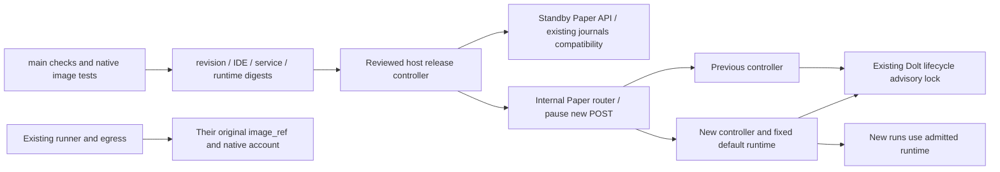

# Paper 执行面的自动发布

2026-11-07，用户明确授权：Paper 执行面也自动升级，已有策略沿用原版本，新启动使用新版本，
不能因发版打断已有 Paper。包括必要主机配置、控制器交接及准入/健康检查；不授权真实账户、
凭据读取、策略重启、数据迁移或删除。

策略代码与运行时是每个 run 已有的不可变输入；`paper_runs.image_ref` 已固定 digest，恢复复用
原容器。无需新增 run.controller_version，也不改 run、源代码、checkpoint、账户、订单或资金状态。
控制器与策略容器分开：可以替换 HTTP/维护进程，但不能对 runner/egress 发 start、stop、rm。
现有 `paper.recovery.operation` 的 Dolt advisory lock 已跨进程串行化 start/stop/seal/resume。

控制器候选读取真实持久 Paper 路由判断 active/standby；standby 只读，不接受 POST、不自动封存
或恢复。健康探测验证现有 journals 可读、现有 image_ref 的 runtime contract 可解析，不能只
检查新 runtime。切换时暂停新 POST，在候选中通过 PIPE helper 取得既有生命周期锁；确认
旧服务使用同一锁协议后才停旧控制器、更新路由配置并切流、释放锁。随后 90 秒观察期间仅暂缓新 start，已有运行可查看、stop、resume；事务提交后才
开放新 runtime 的 start，避免回滚到旧控制器却遗留它不支持的新账户。未提交候选被独立
unfreeze 属于协议不可达状态，保留事务并停止自动操作，不能自动回滚。已完成 start 的声明和
Docker launch 均在锁内；已确认 stop 的 STOP 意图已持久化，由新控制器续接。未确认请求可
使用原 op_id 重试。回滚也先冻结与排空，不通过重启策略恢复。

先建立指向旧 Paper 的内部 router，再让 Web 上游切至它并完成 Web 发布，才首次交接控制器。
旧 API 的连接可能重连；策略进程不因 HTTP 连接寿命停止。新版本只改变后续 start 的默认
runtime，既有 resume 与 reconcile 仍用自身记录的旧镜像。

发布文件预写事务并 fsync，观察中核对 ledger/docker-api 与既有 runner/egress 的 ID、StartedAt、
OOM 和重启计数及行情继续推进；失败恢复旧控制器和路由。未知独立路由改变保留事务并停止。
runtime 镜像全部保留，因为运行固定了它们的摘要；控制器和 Web 的旧容器每种留最新 3 个成功版本和最新 1 个失败版本，其余连同无人使用的镜像在发布完成后删除（用户 2026-11-07 授权）。0.x 版本之间不保持兼容（用户 2026-11-14 决定）：新控制器不读取、不迁移旧格式的运行，它们留在磁盘上；同格式的运行照常交给新控制器，其余由 checkpoint 读取时的格式检查拒绝恢复。

## Web 与 Paper 控制器同版本发布（2026-11-14）

用户 2026-11-14 决定（doctor 20261114-19）：“Paper 失败时 Web 也一并回滚到旧版并把该版本标为失败”。0.x
版本之间不兼容，Web N 配 Paper 控制器 N-1 不是受支持的组合，所以一个版本的 Web（连同 Agent、配对时的 Live
控制）与 Paper 控制器一起到 N，或者一起留在 N-1 并标记该版本失败。此前两者分开提交：Web 先提交，Paper 在 Web
已到同一 revision 后才切换，失败标记也分开，v0.3.0 的 Paper 切换失败后主机停在 Web 0.3.0 配 Paper 0.2.0 约 25
分钟；Web 自己的观察也是经 Web N 读 Paper N-1。

`deploy/release.py` `Release.apply` 的顺序：

1. 事务前的拒绝：Web 侧照旧；Paper 侧的路由一致、内存余量、拉取与 runtime 祖先核对（`PaperRelease.prepare`）也在
   Web 事务之前，暂时性拒绝不标记失败。Live 忙或账户锁占用时照旧直接返回，两侧都不写事务。
2. 写 Web 事务，创建并启动 Web 候选（配对时先建 Live 控制），交接 Agent。
3. `PaperRelease.switch`：写 Paper 自己的事务，预热候选控制器，冻结全部写入、在生命周期锁内停旧控制器，
   把路由切到候选并只冻结新 start。
4. Web 候选预热、切流、观察：此时 Web N 经路由读的是 Paper N，替代原先 Paper 自己经活动 Web 的观察。
5. 提交 Web（提交前同时核对 Paper 仍处于“候选、仅冻结 start”），再提交 Paper（删除 Paper 事务、开放新 start）。

提交前任一侧失败：先回滚 Paper，再回滚 Web，标记 `failed/<revision>`。Paper 回滚时若 Web 事务仍在，由随后
Web 的已验证回滚写标记。

两次提交之间崩溃的规则（`PaperRelease.recover`）：Paper 事务仍在时，只有 Web 事务已删除且 Web 磁盘路由正是
同一 revision 的 `WEB+<sha>`，才向前完成 Paper 提交；其余情况都回滚。Web 在写入磁盘路由后、删除事务前崩溃，
Web 照旧保守回滚，所以 Paper 也回滚。每个 tick 先恢复 Paper、再恢复 Web，两者收敛到同一版本。

`paper-failed/` 目录与独立的 Paper tick 删除；0.x 不读旧标记，升级时主机上残留的 `paper-failed/` 不再生效
（见 `CHANGELOG.md`）。内存余量仍是两侧各自的同一个 2 GiB 检查，没有为两个候选同时运行另加要求。

## 新状态的独立审阅

AGENTS.md 要求添加存储字段前独立审阅。只读子代理 `/root/paper_release_state_review`
已检查消费者和现有实现，并有条件通过下列最小状态；生产旧镜像也必须实际核实同名锁协议。

| 状态 | 消费者及独立事实 | 不能由已有字段推出的原因 |
|---|---|---|
| release.service | 主机拉取已通过原生测试的控制器 digest | IDE digest 不是 service digest，同源码可以多次构建 |
| release.runtime | 新 start 的已准入 runtime digest，没重建时保留上次准入产物 | mutable main tag 及源码不能证明哪个产物已完成检查 |
| Paper transaction.candidate | 恢复本次未提交交接的新控制器 | 当前路由不能区分未提交候选与旧备用 |
| Paper transaction.previous | 回滚到切换前控制器 | 路由改变后不能推导旧目标 |
| failed/REVISION | 该版本的 Web 或 Paper 升级失败或中断，阻止无限自动重试；与 Web 共用一个标记（2026-11-14 起，原 `paper-failed/` 删除） | CI 成功与当前路由不能表达这个主机发布决定 |

actual Paper router 配置本身是实际路由，不另存 owner/active SHA/阶段。runtime 的源码 revision
从 OCI 标签验证，不另存副本；controller 的默认 runtime 已在其不可变 Docker argv 内。
不持久化锁 helper 的 ready 状态，PIPE EOF/进程退出释放既有数据库锁。

## 实现前后核验

生产旧 service 的实际 `paper.recovery.operation` 已实读核实含同名 `paper/paper-lifecycle`
GET_LOCK/RELEASE_LOCK 协议，生命周期调用整体 serialized；旧控制器 UID/GID 为 1000:1000，
默认 runtime 固定为 `ghcr.io/qoeop/trade-runtime@sha256:8948075d6cfe47231ae39cc4ce945ed24239e65bc21ec3f993f6b1f7bee25268`。
发布器持锁 helper 的每次 held 响应都由同一连接核实锁仍属于自己；在停止旧控制器前后重查精确路由，
不能覆盖独立切流。发布前不再检查旧运行的 checkpoint 格式和日志能否被候选读取（用户 2026-11-14 决定）。

本机 Ruff、mypy、Compose dummy 边界和脚本语法通过。完整 suite 初次 1009 项，5 项错误
均为本机 Dolt 1.80.2 与要求 2.4.2 不符，306 项跳过；后续新回归定向复验。
CI 使用固定 Dolt 2.4.2，service 原生检查也实际执行跨进程锁测试。
生产发布与 Paper 容器/默认版本的最终核对见[生产验收](https://github.com/qOeOp/trade/blob/559e8c644b8e986c6102a99abc34b9f1e67506cf/docs/plans/paper-continuous-delivery-acceptance.zh.md)。

## 首次准入与连续 main 提交

首次 V2 准入还没有已批准的 runtime 时，如果较新的 service-only main 已写入 withheld，
旧 runtime 构建来源的回调会因源码单调性不能再覆盖新决定。这不能靠 mutable tag 或跳过检查
解决。发布器在首次缺省时从最近成功的 runtime-main 中寻找候选，验证其为当前源码祖先、该
来源的全部最新工作流/第三方检查通过、run/attempt 是最新且产物精确匹配，才准入其 digest。
没有匹配原生产物的历史 V1 构建跳过，失败或未完成来源继续拒绝。
发布器自身的 main 更新也会自动调和最近产品构建；仍由相同的源代码检查决定是否准入。
