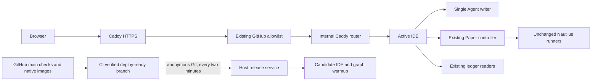

# main 自动发布与 Paper 执行隔离

2026-11-06，用户明确要求：main 检查和构建通过后自动上线，预热、健康检查、切流、失败回滚，
更新不打断运行中的 Paper。主机控制面的安装、内部路由调整和受管网页容器的生命周期属于此授权。
不接触交易凭据、活动账本记录、市场目录身份或策略运行器。

发布入口只管理 Web IDE 与其独立 Agent 服务；Paper 控制器、Dolt、Docker API 和已启动的策略镜像
不由发布器重建。研究/执行平面的协议或存储迁移仍需要单独的兼容性发布；构建了 service/runtime
镜像不代表会把它们替换到活动运行。新的网页仍通过原有只读配置与现有 Paper API 工作。

GitHub Actions 在平台内核验同一 main 提交的全部已触发工作流与第三方检查。原生镜像测试后
上传本 run 的原生成功执行 attempt 的精确 digest（部分重跑沿用最近成功产物）；准入工作流读取该 artifact，将 `{revision,image}` 追加到
`deploy-ready` 操作分支。服务器每两分钟匿名 Git fetch main 与此分支，不读检查 API、部署
私钥或 GitHub token；目标机的匿名 Actions/check-runs API 实测返回 504，Git 拉取正常。
发布器只拉准入 digest，并核验 OCI source/revision/平台。Git、检查或镜像错误均保留当前版本。

准入工作流监听上游 in_progress/completed，并每十五分钟补查迟到的第三方结果，避免依赖
被 GitHub 抑制的 check_suite 事件。只向可信准入 job 提供平台自带的短期 GITHUB_TOKEN 的
contents:write；不执行 PR artifact 中的代码。channel 的提交仅有前一 channel 提交为父，
force=false，源码 revision 也必须单调前进。相同源码允许 image=null 撤回或重新准入。
服务器在切流和提交前重新核对资格；资格改变则回滚。本次 CI 快照不追溯改写已完成的发布，
后续新检查结果不是此前已测试 digest 的替代物。

候选 IDE 不启动本地 Agent，也不挂载聊天卷。唯一 Agent 进程使用既有私有卷；仅 Agent 或其
产品 CLI 依赖变化时替换，先停止旧进程再启动新进程，回滚恢复旧容器。JSON 格式必须向后兼容。
网页切流不复制聊天配置。首次从旧部署拆分时认证代理有一次短暂重连，Paper 容器保持原样。

候选只读预热活动 Paper 对应研究线，确认 Paper、Agent、overview 和研究图可用后，使用 Caddy
的原子 reload 切流；读回实际路由并进行观察，失败恢复旧路由和 Agent。旧网页的令牌失效仍被
原检查拒绝，只对已确认未转发的同源拒绝返回新 nonce，客户端原 operation ID 最多重试一次。
不重试上游业务拒绝或不确定的网络错误，不放宽 Host、同源或令牌匹配条件。

最多同时运行旧活动与新候选两个 Web 实例；开始下一次发布前停止更早的受管备用网页容器。
网页有 CPU/内存上限和较高 OOM 分数，低可用内存时不开始候选。整个发布过程中读回受保护
容器身份与 OOM/重启状态。这里不宣称单机可以承受任意数量的策略或灾难故障。

## 新操作状态的独立审阅

按 AGENTS.md，独立只读子代理 `/root/release_state_review` 在实现前审阅并有条件通过。
这些是主机发布控制状态，不是策略研究数据，不进入研究账本。

| 内容 | 消费者与独立事实 | 为什么不能从已有事实推导 |
|---|---|---|
| release.revision | CI 准入或撤回所针对的 main 提交；用于 ancestry 和 OCI 交叉核验 | image=null 时也需要对象；不能用镜像自述代替 CI 的外部决定 |
| release.image | 本次原生测试通过的精确 artifact digest；null 为撤回 | 同 SHA 可有多个构建，当前 SHA tag、源码与 OCI label 均不能推出哪个产物被检查 |
| transaction.candidate | 恢复程序、阻止重试；本次未提交的 Web 目标 | OCI revision 不区分本次目标、旧备用与以前失败候选 |
| transaction.previous | 恢复程序；切流前已提交的 Web 目标 | 切流后当前路由已改变，创建顺序和 Git 顺序不证明曾经接流量 |
| transaction.agent_before（仅替换 Agent 时） | 恢复单写者；旧 Agent 的容器身份，bootstrap 为 null | Agent 可能早于旧 Web，当前网络别名也不能恢复旧身份 |
| failed/REVISION | 自动选择；该提交曾失败或中断、未成功提交，不再自动尝试 | CI 成功与当前路由均不能表达这个主机发布决定 |

独立审阅也明确通过 release.revision/image 两项：artifact 精确绑定和 CI 资格是不同于源码的事实。
不存 agent_after（由 candidate revision 与固定命名推导），不增 active SHA、阶段、时间戳或指标
副本。active.json 本身是实际持久路由配置。事务先落盘再改 Agent/路由，文件与父目录 fsync；
事务删除是提交点。恢复分别检查磁盘配置与 Caddy 已加载配置，未知路由停止自动操作，回滚失败
保留事务和两侧容器。容器名不复用，操作前核验受管命名空间和 OCI 身份。

依据：[Caddy reload 与失败回退](https://caddyserver.com/docs/api#post-load)、
[流连接延迟关闭](https://caddyserver.com/docs/caddyfile/directives/reverse_proxy#stream_close_delay)、
[GitHub 公共 workflow runs](https://docs.github.com/en/rest/actions/workflow-runs#list-workflow-runs-for-a-repository)。

## 实现验证（2026-11-07）

- Web 构建与 90 项前端测试通过；nonce 续期只重试未转发的拒绝，保留同一 operation ID。
- Ruff、108 模块 mypy、dummy Compose 边界、安装脚本语法、PR 标题检查通过。
- 系统 Python 3.12 下 17 项控制器测试通过，含首次接入、切流前后失败、崩溃恢复、资格撤回、
  独立路由或 Agent 变更与 Paper 进度检查。控制器使用独立 py312 lint 配置，不依赖产品 Python。
- 7 项 Node CI 准入测试通过；固定版本原生 Caddy 的 2 项真实切流/SSE/失败回退测试通过。
- 完整 Python suite 实测 937 项：5 个错误均为本机 Dolt 1.80.2 与项目要求 2.4.2 不符，
  304 项跳过；新增首次接入回归后定向重跑通过。完整 CI 使用固定 Dolt 2.4.2。
- 独立审阅发现并修复 Agent handoff 与首次接入/恢复的路由检查时序缺口，依赖判断包含 Dockerfile。

服务器安装和首次自动发布的实际证据另行追加；此处隔离测试不代替生产验收。

## 首次接入的权限缺陷（2026-11-07）

候选 Web 去掉全部 capabilities 后，root 无法读取服务 UID 拥有的 0600 reader 文件，
`/api/lines` 拒绝为 `LEDGER_UNKNOWN`。健康检查阻止切流，旧网页和嵌入 Agent 保持运行；
没有修改 reader 文件、其权限或账本。修复仅授予 `DAC_READ_SEARCH`，使 root 能读取既有私有
reader 文件并保留 root 的 Agent 私有目录；不增加 DAC 写入绕过，研究/市场挂载继续只读。
双架构 CI 用无敏感内容、不同 UID 的 0600 fixture 验证可读及写入仍为 EROFS。
