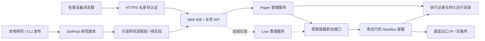

# 固定 IP 服务器与 Web IDE 远程运行探索

2026-11-06。代码基线 `3e8c768d09bd03d6d831497251c9a6462062fd25`。用户确认：Web IDE 也部署到服务器，浏览器随处访问；首批目标为 Paper/Live 合计 6–20 个策略实例。本轮为探索，不开通服务器、不迁移活动目录、不修改并发或拒绝规则、不读取凭据、不连接真实账户。

## 推荐结构

用户最新明确研究留本地、DoltHub发布成果、云端负责展示和长期执行，服务器改选亚洲。此前整体搬迁的一体化部署与64/128GiB选型建议已被修订，现以[服务器候选与部署分工](remote-paper-server-choice.zh.md)为准。第一阶段可共用一台云主机承载HTTPS登录、IDE和Paper，但研究任务不进入执行主机；新的remote overlay已完成研究/执行数据路径分离，本地默认Compose仍保留一体化；实现与权限边界见[分离记录](remote-paper-data-split.zh.md)。浏览器关闭、本机休眠或连接断开均不结束策略，无需因此引入Kubernetes、消息队列或通用调度器。

图是业务关系，非任意共享挂载：IDE 继续只读研究账本；Paper 使用现有 CLI 写入；每个 runner 只能写自己的输出目录；Live 的密钥、账户原件及访问权限另设私有边界。交易订单、成交、账户和风控仍由 Nautilus 持有。

固定 IP 包含两个验收项：域名指向可保留的公网入口；运行容器的外部请求使用已确认的固定 IPv4 出口。前置代理、CDN 的入口地址不能充当交易出口证明。若未来拆多台执行服务器，每台出口或统一 NAT 出口都需明确；不能依靠动态公网地址或意外 IPv6 路径。AWS Elastic IP 是可保留、可重新关联的区域性 IPv4，但换绑不会迁移进程、磁盘或账户状态。[AWS 文档](https://docs.aws.amazon.com/AWSEC2/latest/UserGuide/elastic-ip-addresses-eip.html)

## 已有能力与实际差距

| 事实（当前代码） | 对远程部署的影响 |
|---|---|
| `deploy/compose.yaml` 已包含 ide、paper、ledger、market-import、docker-api；前端通过同源 `/api/paper` 发起操作 | 可把整套放到服务器，浏览器无需 SSH，也无需直接连接 Docker |
| `ide/research_graph/serve.py:handler` 使用 Host、Sec-Fetch-Site 和页面 token | 这是本机同源/CSRF 防护，不是用户登录；公网入口必须新增身份认证并覆盖页面、API、SSE、聊天全部路由 |
| IDE 只发布在 loopback；内部 Paper 端口未公开 | 保留内部服务隔离；通过 HTTPS 入口接入域名，明确可信代理、Host 转发与原站访问路径，不删除已有检查 |
| `paper/runs.py` 的 MAX_RUNNING=4；同 source 同时只允许一条运行 | 6–20 尚不支持；容量验证后另行提出限制变更，不能只改常量或复制多个 daemon 绕过限制 |
| 一条 Paper 是独立 runner + egress，runner 内还包含其私有 Redis 子进程 | 6–20 条 Paper 是 12–40 个动态容器，加基础服务；币种数量与策略实例数不是同一容量维度 |
| Compose 基础服务有 restart/log rotation；`runtime/container.py:paper_command` 没有显式 restart/log rotation/CPU 限额 | 动态容器不会继承 Compose 的设置；长期日志、资源边界与恢复须针对动态运行处理 |
| `paper/recovery.py` 验证同一未封存 run、检查点、源码、原容器与镜像 | 支持有条件的同机恢复；缺失/dirty/不支持状态保留原件并停止。不是跨机恢复或任意崩溃保证 |
| runtime/IDE/service 的发布工作流只构建 linux/arm64，service Dockerfile 也固定 ARM64 Dolt | ARM64 可复用当前镜像；x86 服务器需要先补 amd64 CI 构建和成对 native 行为验证 |
| `runtime/image.py` 仅列 replay/paper/egress 模块；当前未找到真实 venue execution client 配置 | Live 是待建设执行路径，不能把 Paper 的名称或一个环境变量改成 Live 就启用 |
| 前端 Paper start 未传稳定 op_id，daemon CLI start 也未传；CLI 本身已支持 op_id | 弱网超时后的重试可能成为另一条启动请求；需要从一次用户操作到 CLI 传递稳定身份并查回结果 |

HTTP 超时只表示调用方未获得结果，不表示容器没启动。现有同source活跃检查能拒绝并行重复启动，但响应丢失后若首条run已结束，重试会得到新的随机op_id，不能可靠查回首次操作的结果。第一阶段优先让已有 CLI 的幂等身份贯穿业务请求，重连后从服务器查状态；在证明确有必要前不另建持久任务队列。API 应只接收候选版本、范围和受限资源配置，不能接收任意 shell、Docker 参数、宿主机路径或密钥内容。

## 页面交互

- Run 选择 Paper 或 Live、执行服务器、策略版本与交易范围；第一阶段只有一个已配置执行服务器。Live 在执行服务及其验收完成前明确不可用，不能自动回退到 Paper。
- 用户看到运行 ID、所在服务器、运行模式、源码版本、镜像版本、行情时间、账户/仓位/订单、健康和最近操作结果。已有事实从 run、原生事件及容器检查读取；CPU/内存/磁盘是当前遥测，不重复写为研究历史字段。
- 将“浏览器未连接”“控制服务未连接”“运行器已退出”“行情过期”“恢复被拒绝”分开呈现。网络失联时显示最后观测时间，不推断策略已停，也不把资金显示为零。
- Paper 的 Start、Resume、Stop 使用现有业务语义：Resume 不是新账户，显式 Stop 是最终结束。不要直接暴露 Docker pause/unpause；冻结进程不能说明订单、行情和时钟得到了正确承接。
- Live 的“停止策略”“撤销订单”“平仓”必须分别定义；停止容器不会自动消除交易所持仓。界面应显示动作针对的账户/策略及影响范围，由 Nautilus 执行动作，不能由前端推算或合成成交。
- 容器视图只管理本产品拥有的运行，不提供通用任意容器 shell。停止与重启的结果以服务器后续观测确认，不能在 POST 返回时就显示为已完成。

## 服务器边界与长期运行

1. HTTPS 入口接成熟身份系统（例如 OIDC + MFA），后端只接受可信入口；保留同源与 CSRF 检查。长连接代理须验证 SSE flush、超时、重连和登录过期，避免把正常日志流缓冲成“页面不更新”。oauth2-proxy 的官方配置明确提供 streaming flush、upstream timeout 与 WebSocket 选项。[官方配置](https://github.com/oauth2-proxy/oauth2-proxy/blob/master/docs/docs/configuration/overview.md)
2. Docker socket、Dolt 和内部管理 API 不公开。当前 HAProxy 只过滤方法/路径，不能校验 create body；被攻破的管理服务仍可能创建任意宿主挂载。服务器阶段需要把启动边界收紧为固定镜像/模块、运行目录、uid、网络、资源与所属运行的校验。rootless Docker 可作候选，但 cgroup v2/systemd、目录权限和资源限额必须先实际探测，不能直接声称兼容。[Docker 安全](https://docs.docker.com/engine/security/)、[rootless 限制](https://docs.docker.com/engine/security/rootless/tips/)
3. 一个生命周期控制者负责恢复。基础服务可用 Docker restart policy；策略恢复继续走 run/checkpoint 校验与既有限速，不叠加另一套盲目重启循环。unhealthy 是健康观测，不能等同已退出；进程尚在但无行情需要单独处理。live-restore 只减少 daemon 维护中断，不解决宿主机断电或原生状态恢复。[restart policy](https://docs.docker.com/engine/containers/start-containers-automatically/)、[live restore](https://docs.docker.com/engine/daemon/live-restore/)
4. 操作系统、Docker 和控制服务正常开机启动；磁盘未挂载、账本未就绪时不得启动到空目录。停机给检查点排空时间，镜像更新只影响新运行或受控重启，不能自动替换所有活跃 runner。
5. 为动态容器设置有限 Docker 日志；交易事件及原生恢复原件保留到持久运行目录，不随日志轮转删除。磁盘满、inode、时钟、行情延迟、原生事件异常和恢复拒绝纳入健康展示与可配置通知；不是只看 CPU 和容器绿灯。[Docker logging](https://docs.docker.com/engine/logging/configure/)
6. 备份包括研究账本既有备份机制以及不可重现的运行原件；备份活动 journal/cache 时保持一致切点。新服务器的可重建 market cache 按需构建，不新增实时全市场采集服务。单机是明确的单故障点，备份/固定 IP 不能代替高可用。

## 容量与服务器选型

读到的事实：当前 market 目录约81 GiB（`du -sh` 的近似读数）；一次 Docker 观测中，IDE约1.15 GiB、Dolt约1.37 GiB，且都占用多个CPU核；run8仍处于等待阶段，runner约68 MiB。**这不是活跃交易负载基准，也不能用等待阶段内存乘20来选机器。**

内存cap不是预留或实际用量，runner的4g上限本身也是未校准示例；不再把这些上限求和作为采购依据。研究留本地后，先评估4 vCPU、8–16GB、持久SSD的亚洲月付主机。完整候选、价格及架构限制见[服务器候选与部署分工](remote-paper-server-choice.zh.md)，不是6–20条或Live容量承诺。

先做现行1–4实例阶梯及24–72小时验证，观察native回调/检查点、CPU、RSS峰值、可用内存、磁盘增长、SSE及UTC日线/funding边界，再提出6/12/20阶梯与并发限制变更。回测、批量导入、研究Agent留本地，不把81GiB历史缓存视作必须整体复制的数据。

本轮不按旧广告报价选商家。最终地区由账户可用地域、公共行情与后续venue连通性、延迟及恢复测试共同决定；固定IP与可访问交易接口是不同验收项。

## Live 与多执行服务器的后续边界

Live 复用控制入口和可观测性，不复用Sandbox初始余额或Paper资金解释。执行用Nautilus官方venue adapter、真实账户同步/重连/对账、原生保护单与风控。多个策略共用一个真实账户时，先确定唯一账户执行owner；不能把每个Paper容器的独立Sandbox账户模型直接套到同一真实净仓账户。

密钥只在服务器私有执行边界，按账户授权；浏览器、IDE聊天进程、Paper容器、日志与公开Dolt研究账本均不得拿到密钥。Live账户/交易明细的保存策略也是独立的私有边界，不默认追加到公开研究账本；不得新建一套自行结算的平行账户引擎。本轮不确定新表或字段，实施前按AGENTS做独立存储评审并确认相应授权。

第一阶段控制服务和执行端同机，节点可作为部署配置显示。将来一个IDE管理多个执行服务器时，应扩展服务器端运行后端，而不是让浏览器选择任意DOCKER_HOST。每个执行端使用本机磁盘与Docker，节点间认证并限制可接受操作。Docker远程bind mount解析的是daemon所在主机路径，不能把本机路径直接发送过去。[bind mount文档](https://docs.docker.com/engine/storage/bind-mounts/)

多节点时必须明确run的权威所属节点和失联行为。当前daemon会遍历整个账本，容器发现只看本机，ledger_key还包含service_root绝对路径；不能让多个daemon共享账本后各自“找不到就恢复”。节点归属可能是新增不可派生事实，须独立存储评审后再定，不用容器是否在线来推断。离线节点不得由另一节点自动启动相同Live账户；跨机接管需明确交接和防双执行，当前恢复协议不支持缺失原容器时重建。

## 分阶段交付与验收

| 阶段 | 交付和通过条件 |
|---|---|
| 1：公网部署边界 | 单服务器HTTPS登录、内部服务不可绕过、受限启动边界、相同CLI协议；已登录浏览器可查看与启动隔离Paper，未登录所有业务路由不可访问 |
| 2：远程Paper运行体验 | 幂等启动/结果查回，弱网与多标签重试只产生一条run；关闭浏览器、重启IDE不影响runner；SSE重连显示真实服务器状态；安全点恢复原run，不支持状态明确暂停 |
| 3：容量与运维 | 6/12/20实例阶梯及24–72小时持续工程验证，覆盖日线/funding边界、控制服务重启、磁盘压力、原生挂起；结果确定硬件和限制变更。直到完成前保留现行4条上限 |
| 4：迁移 | 确认唯一活动账本/市场目录与新主机路径，备份与历史可读性、回滚方案；现有run8不能假装跨机续接。迁移活动目录与部署须具体授权后实施 |
| 5：Live | 单独实现Nautilus真实执行服务、私有凭据/账户边界、动作语义与对账验收；任何testnet、真实venue连接或真实交易都须另行明确授权 |

阶段1–2的认证与控制能力已由#2211/#2212交付，未部署亚洲服务器，数据路径分离随后已实现并隔离验证，见[实现记录](remote-paper-data-split.zh.md)。已知预算500元以内、域名www.vibe-trading.info、GitHub指定账号登录、亚洲机房；欧洲32GB候选取消。本文修订未修改活动数据、运行容器、主机或DNS，Live仍后接。
