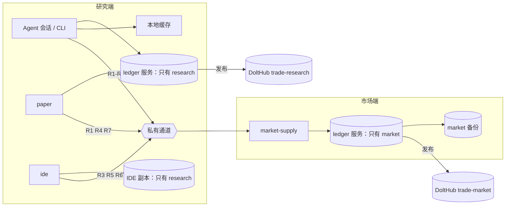

# 本机不放市场库也能做研究：设计方案（2026-10-30，待用户确认）

用户要求：本机不放市场库也能做研究。本文写清哪些读取要改走远端、ledger 和市场库怎么拆、远端放哪，以及验收标准。
本文只是方案，不改代码，也不动部署。初稿已经由一个独立子代理对照 `b7b696621` 的代码审过，本版已按它的意见修订。

## 1. 目标

- **研究端**：Agent 会话、研究账本、原生回放、Paper 和 IDE 所在的机器。它不再存市场库，只存研究账本、运行镜像和
  可删除的缓存。例如本机只有 100 GB 可用、市场库有 1 TB，研究也能照常进行。
- **市场端**：另一台机器，持有完整的市场库。导入、备份、review 和发布到 DoltHub 都在这里做。供数服务也跑在这里，
  向研究端提供只读读取。
- 回放、审计和研究账本里的记录都不变。市场库在研究账本里的身份（数据库名加固定 commit）也不变。拒绝行为只在 §6
  列出的地方变化，每一处都要用户授权。

不在本次范围内：接 TradeTick，扩大导入范围，改撮合模型。

## 2. 现状（2026-10-30 实测）

本机现在存了三份市场库：

| 位置 | 内容 | 大小 |
|---|---|---:|
| `trade-ide_trade-dolt-data` 卷 | `ledger` 服务托管的 `research` 和 `market`（研究账本不到 1 GB） | 66.7 GB |
| `trade-ide_trade-ide-data` 卷 | IDE 自己的只读副本，克隆了 DoltHub 上的 `research` 和 `market` | 56.5 GB |
| `$TRADE_DATA/dolt-backups/market` | 市场库的 `dolt_backup` | 60 GB |

宿主机还剩 581 GiB 可用。全量 aggTrades 入库后，市场库预计约 331 GB（10-30 Codex 的容量估算）。照现在的结构，
这三份都会跟着涨。

#1906 和 #1909 只把**回放和登记的行情输入**改成了远端供数。研究端仍然直接读市场库的地方如下：

| # | 读取 | 代码 | 谁在用 |
|---|---|---|---|
| R1 | 回放和登记的输入：commit 解析、成员规则和月份、成员路径、生命周期证据校验、窗口导出 | `registration/seams.py` 的 `MarketAdapter` | `registration add`、`replay explore/precheck/run/reproduce`、`validation registration`、`market lifecycle`。**已能走远端** |
| R2 | 市场新鲜度：universe 月份、合约数、最新分钟、最近完整日和月、导入范围 | `market/store.py:881` `freshness` | `line select`（`cli/main.py:163`），research-start |
| R3 | 覆盖诊断：窗口内的成员、逐合约逐月的 bars/quotes 覆盖、生命周期回执 | `market/coverage.py:181,192`；`cli/main.py:949-957` | `market coverage`：research-start 的就绪检查、IDE 聊天工具 |
| R4 | 存储的 K 线和资金费 | `market/read.py:102` `stored_bars` | `market bars`（research-round）、`paper reconcile`（`paper/reconcile.py:274`，整段不设上限） |
| R5 | 市场日收益（BTC 永续和可交易范围等权） | `market/read.py:50` `daily_returns`；`report/seams.py:41` | 读报告时算市场度量：`replay report`、`hypothesis compare`（`report/comparison.py:380`）、`research graph`（含 IDE 的图）、IDE 聊天工具的 `replay report` |
| R6 | 线固定的 commit 还在不在现用市场库里 | `report/seams.py:52` `_market_commit` | `research state` 的门槛（`report/status.py:526`），research-start、IDE 聊天工具 |
| R7 | Paper 启动时取成员 | `paper/runs.py:98` 直连 `store` | `paper start` |
| R8 | 服务健康检查：先读研究账本，再读市场 schema | `cli/service.py:309` `check`；`cli/main.py:2061` | `ledger` 容器的 healthcheck |
| R9 | IDE 每看到新的账本 head，就拉一次市场副本 | `services/ide/research_graph/serve.py:262` `_pull("market")`；`docker/replica.py` | IDE 的实时刷新 |
| W | 管理和写入：`market init/import/import-quotes/import-trades/upgrade/backup/review/publish` | `cli/main.py:2033-2047` | 只在导入数据时用 |

另外还有两处结构上的绑定：

- `ledger service run` 第一次启动时，会同时克隆 `research` 和 `market`，缺任何一个 origin 就拒绝（`cli/service.py:159`）。
  `service.json` 里两个库的账户都有。profile 目录里只要有任何 `*.json`，自举就拒绝（`cli/service.py:156`）。
- IDE 的 entrypoint 第一次启动时会克隆 `market`。`MARKET_REMOTE` 有默认值，市场账户和带 `service` 的 `market.json`
  都是写死的（`services/ide/docker/entrypoint.sh`）。

## 3. 目标结构

- 研究账本还是在研究端：每次写入照旧发布到 DoltHub，备份也照旧。
- 市场库只在市场端：导入、发布、备份、review 都在那里做。DoltHub 还是公开副本，也是市场端第一次启动时的克隆来源。
- 研究端所有市场读取都经同一个入口，去问市场端的 `market-supply`。研究端的任何代码都不再直连市场的 SQL。

## 4. 各部分怎么定

### 4.1 一个读取入口

现在 R1 的 `_market(profile)` 是按 profile 选本地 `Market` 还是 `RemoteMarket`（`registration/seams.py:211`）。
把这个入口扩成**市场只读面**，R2–R7 的调用方都改成从这里拿：

| 方法 | 本地实现（原样调用现有函数） | 远端实现 |
|---|---|---|
| `resolve_commit`、`universe_rule`、`universe_month`、`membership_path`、`validate_lifecycle`、`export_catalogs` | 已有 | 已有（#1906） |
| `freshness(commit)` | `store.freshness` | 新 RPC |
| `universe_members(commit, start, end)`、`diagnose_coverage(commit, symbols, start, end, lifecycle)` | `market.coverage` | 新 RPC；结果可能超过 16 MB，见下 |
| `stored_bars(commit, symbol, price_type, timeframe, start, end, limit)` | `market.read.stored_bars` | 新 RPC；结果可能超过 16 MB，见下 |
| `daily_returns(commit, universe_rule, start, end)` | `market.read.daily_returns` | 新 RPC |
| `commit_known(ref)`：返回 commit，或者明确返回“没有这个 commit” | `store.resolve_commit`，把 `UNKNOWN_REF` 变成 `None` | 新 RPC |

规则如下：

- **服务端调用的就是本地实现的同一个函数，但要逐个方法定编码。** 参数和结果里有 `date`/`datetime`（如 `freshness`、
  `daily_returns`）和字节串（`diagnose_coverage` 的生命周期文件）。现在的 `canonical()` 序列化不了这些类型，
  会变成 `MARKET_REMOTE_INVALID`（`market/remote.py:41`）。下游代码要的也是真的日期，比如 `ledger/lines.py:201` 会拿
  `latest_complete_day` 去加 `timedelta`。所以每个方法要有自己的编解码，客户端拿回来的 Python 值要和本地调用完全相同。
  拒绝原样带回：`UNKNOWN_REF`、`MARKET_EMPTY`、`RULE_VERSION_MISMATCH`、覆盖缺口等，错误码、文字和 `missing` 都不变。
- **大结果走对象下载。** `stored_bars`（`paper reconcile` 读整段）和不带 `--symbols` 的 `diagnose_coverage`（全池加上
  不限长的缺口列表）都可能超过 16 MB 的元数据上限，而本地调用不会失败。超过上限时，结果写成文件，走 #1906 已有的
  按内容寻址的对象下载和校验。
- **R6 不能复用 `resolve_commit`。** 服务端的 `Market.resolve_commit` 会把 `UNKNOWN_REF` 变成 `MARKET_COMMIT_UNRESOLVED`
  （`registration/seams.py:153`），而 `_market_commit` 遇到任何 `Refusal` 都返回 `None`，意思是“读不到”。这样走远端时，
  “commit 已不在”的门槛就永远不会出现。所以单独加 `commit_known`，把“没有这个 commit”和“读不到”分开。
- 和 #1906 一样，引用只解析一次，之后的读取都要完整 commit。供数端只开放白名单里的方法，不开放 SQL、写入或任意文件路径。
- **只有远端的 profile。** 研究端的 market profile 不写 `service`。读取命令都经过入口；`store.connect` 遇到缺 `service`
  会报 `MARKET_UNREACHABLE`（`market/store.py:152`）。但有四个管理命令会直接抛 `KeyError: 'service'`，变成未处理的异常：
  `market review`（`report/review.py:117`）、`market backup`（`ledger/admin.py:306`）、`market publish`（`cli/main.py:882`）、
  `market upgrade`（`ledger/db.py:930`）。改为：拿到只有远端的 profile 时，这些命令统一明确拒绝，说明它们只能在市场端跑（§6 第 6 条）。
- R7 不需要新方法，用已有的 `resolve_commit` 和 `membership_path` 即可。

这一步不新增研究账本字段，不改报告的计算方式。

### 4.2 ledger 拆开

`ledger service run` 改为只托管给了 origin 的那几个库：

- **研究端**：只传 `--research-origin`。自举时只克隆 `research`，`service.json` 只有研究账本的账户，只写 `research.json`。
  只有远端的 `market.json` 必须在第一次启动**之后**再写，因为 profile 目录里有任何 `*.json`，自举都会拒绝。
- **市场端**：只传 `--market-origin`。只托管 `market` 及其账户、备份和发布。`market import*`、`market backup/review/publish`
  都在市场端的宿主机或容器里跑。
- **R8 两边都要改**：
  - 研究端的服务里没有市场：只有远端 profile 时，改为检查 `commit_known('main')`。
  - 市场端的服务里没有研究账本：现在的 `check` 先解析现用研究账本（`cli/main.py:2061`），找不到就报 `LEDGER_UNKNOWN`。
    这样 `ledger` 永远不健康，依赖它的 `market-supply` 也起不来。所以改成只检查服务里实际托管的库。
- **一份 compose，两组服务。** 用 compose profile 分开：研究端是 `ledger`、`paper`、`ide`、`docker-api`，市场端是
  `ledger`、`market-supply`。两端 `ledger` 的命令不同：现在的命令总是带着有默认值的 `--market-origin`，所以每端要有自己的命令。
  不另造第二套部署。

本机原来的 `service.json` 里有两个库。切换时它不会被改写，而是新建一个只有 research 的服务（§6 第 3 条）。

### 4.3 IDE

IDE 现在克隆 `market`，是为了算图里的市场度量（R5）、`research state` 的门槛（R6）和聊天工具的 `market coverage`（R3）。
改为：

- entrypoint 加一个明确的开关，研究端部署关掉市场副本，不克隆 `market`、不建市场账户。IDE 的 market profile 写成指向供数服务。
  因为 `MARKET_REMOTE` 有默认值，“不给就不克隆”行不通，必须是显式开关。
- R9：只有远端时，新 head 到来不再拉市场副本。否则会出 `PULL_FAILED`，页面就停止刷新了。
- 聊天工具会跑 `research state`、`replay report` 和 `market coverage`，超时是 180 秒（`services/ide/agent/src/tools.ts:82`）。
  走远端后要实测这三个命令能在超时内返回。
- IDE 的 `research` 副本保留：它要能读公开账本，研究账本也不大。

### 4.4 Paper

R1 已经走远端（#1909）。R4 和 R7 改走入口之后，Paper 容器就不再需要本地 reader，`paper-market` profile 去掉 `service`。
实时行情还是 Binance 公开数据，和市场库无关。

### 4.5 市场端放哪

硬性条件：

- **linux/arm64 的 Docker 引擎。** 镜像只构建 arm64（`.github/workflows/ide-image.yml`）。
- **磁盘。** 全量 aggTrades 后，活动库约 331 GB。Codex 按保留旧备份、做一次新完整备份和一次恢复核验算过，建议准备
  1.2–1.5 TB。
- **内存。** 导入时 Dolt 服务 RSS 采样峰值是 7.63 GiB，供数导出也在这台机器上跑，建议 16 GB 以上。
- **一直开着**：研究端每次正式回放，都要在市场端做一次 fresh 导出。

可选的地方：

| 选项 | 好处 | 代价 |
|---|---|---|
| **A. 云上 ARM 虚拟机加块存储**（如 AWS Graviton、Hetzner CAX） | 在哪都能连；下载 Binance 归档和发布到 DoltHub 走机房带宽 | 按月付费，1.5 TB 块存储是主要成本 |
| **B. 家里另一台 arm64 机器**（如 Mac mini 外接 SSD，或 ARM Linux 小主机） | 不付月费；局域网带宽高 | 要一直开着；出门时要经 VPN；导入和发布受家庭上行带宽限制 |

**推荐 A。** 导入要下载上百 GB 归档、发布要上传整库的增量，云上这两步都快得多；而且研究端换机器、出门都不用管网络。
如果更在意月费，B 的结构完全一样。

### 4.6 网络和访问控制

供数服务没有认证（`market/README.md`），所以只能通过私有通道访问：

| 方式 | 适合 | 要做什么 |
|---|---|---|
| **SSH 端口转发** `ssh -N -L 127.0.0.1:8210:127.0.0.1:8210 market-host` | 单台研究机，起步用 | 不用装软件；研究端 profile 的 `remote_url` 仍然是 `http://127.0.0.1:8210`；Paper 和 IDE 容器要通过宿主机访问隧道（验收时实测） |
| WireGuard / Tailscale | 多台研究机 | 两端装客户端，供数服务只监听私网地址 |
| HTTPS 加认证 | 公网直连 | 要写认证代码，现在不推荐 |

**推荐先用 SSH 转发，**有第二台研究机时再换私网。供数服务在市场端仍然只发布在回环地址上。

### 4.7 缓存、导出、并发

现在两边都不会自动清理（#1906）。研究端变小之后，这件事就必须处理：

- **研究端缓存**：新增 `market cache prune --keep-gb N`。它持有和下载相同的锁，只删当前没有回放在用的条目。
  - 删对象时要连同引用它的请求清单一起删。否则客户端会直接用缓存的非 fresh 清单、跳过 RPC（`market/remote.py:197`），
    而服务端重启后对象索引已经清空，下载对象会 404，于是永远报 `MARKET_REMOTE_UNAVAILABLE`。
  - 另外，客户端下载对象遇到 404 时，退回重新发 RPC 取新清单。
  - 并发安全靠 Agent 自己做不到，所以算产品代码。
- **市场端导出**：只有 fresh 的 `market-export-*` 目录在服务重启后就用不上了，因为对象索引只在内存里。非 fresh 的导出
  （`market/export.py:469`）重启后还会复用，不能删。改为：启动时只清 fresh 目录；运行中 fresh 目录超过 M GB 时，
  删最旧且不在下载中的。这是现有缺陷，单独一个 PR。
- **并发**：供数端所有导出都排同一把锁（`market/remote.py:301`），客户端超时是 3600 秒（`market/remote.py:91`）。并行跑几条
  研究线时，导出会排队，排在一个长的 fresh 导出后面的回放可能超时。先在验收里实测两个回放同时跑；排队是否要改，看结果再定。

### 4.8 版本一致

现在每次 RPC 都核对导出器指纹（`EXPORTER_FILES`，`market/export.py:430`），这里有两个问题：

- **覆盖不全**：它没包含 `market/read.py` 和 `market/remote.py`。改了 `daily_returns` 或 `stored_bars` 之后，服务端还会用
  旧代码算，不会拒绝。改为：加一份覆盖所有被供数读取所用文件的指纹，每次 RPC 一起核对。导出器指纹本身不变，因为它是
  回放输入身份的一部分。
- **影响面**：指纹一不一致，不只是回放被拒，R2–R7 也全部被拒，包括 `line select`、`market coverage` 和报告的市场度量。
  例如 `uv.lock` 一升级，在市场端重新部署之前，研究端这些命令都用不了。

所以部署顺序是：凡是改了这些文件的版本合并后，先更新市场端的 `market-supply` 镜像，再更新研究端的检出。
顺序反了，命令会被拒绝，但不会出错数。

### 4.9 市场端不可用时

现在各命令的反应不一样。下表是不改代码时会发生的事，以及建议怎样：

| 命令 | 不改代码时 | 建议 |
|---|---|---|
| `registration add`、`replay *`、`validation registration`、`market lifecycle`、`market coverage`、`market bars`、`paper start/reconcile` | 拒绝 `MARKET_REMOTE_UNAVAILABLE`，不写研究账本 | 保持 |
| `line select` | 任何市场拒绝都改写成 `MARKET_COMMIT_UNRESOLVED`（`ledger/lines.py:190`），看不出是连不上 | 保持拒绝，但在 `missing` 或文字里带上原来的错误码 |
| `replay report`、`hypothesis compare` | 市场度量变成 `{error}`，其他照常（`report/measures.py:595`） | 保持，验收确认报告里写明了限制 |
| `research graph`（含 IDE 的图） | `MARKET_REMOTE_UNAVAILABLE` 不在 `ENVIRONMENT`（`report/graph.py:31`）里，图会**悄悄**画出没有市场度量的版本。它自己的规则说这样的图是错的 | 把 `MARKET_REMOTE_UNAVAILABLE` 加进 `ENVIRONMENT`，和现在 `MARKET_UNREACHABLE` 一样拒绝（§6 第 5 条） |
| `research state` | 读不到时门槛直接不出现，命令正常退出 | 读不到时加一条“市场不可用，无法核对”的门槛；`commit_known` 明确说没有这个 commit 时，出现原来的门槛（§6 第 5 条） |

研究账本的写入和发布不依赖市场端。

### 4.10 skill

`research-start` 和 `research-round` 里，导入月份（`market import`、`market import-quotes`）要写清楚是在市场端做的
公开写入，仍然由用户决定。研究端看到的数据新鲜度，以远端 `freshness` 为准。只改写法，不改规则。

## 5. 研究端磁盘预算

| 项 | 量级 |
|---|---|
| 研究账本、它的备份和 IDE 的 research 副本 | 各 1 GB 以内 |
| 镜像：`trade-service`、`trade-ide`、`trade-runtime` | 约 4 GB，另加保留的旧版本 |
| 回放：本地缓存，加每次回放的独立输入副本 | 例如 BTCUSDT 一个月带报价，约 220 MB 加 220 MB；全池或多年窗口要在验收中实测 |
| 回放输出（`/tmp`，可删）和 Nautilus 运行 | 内存约 3 GB；磁盘看窗口大小 |

所以 100 GB 的研究端是够的，前提是 §4.7 的缓存清理有了。

## 6. 需要用户授权的点

1. **市场端放哪、花不花钱**（§4.5）：A 还是 B，规格多大。
2. **网络路径**（§4.6）：研究端到市场端的私有通道，以及要不要在两端装客户端。AGENTS.md 规定改网络路径要授权。
3. **建新的活动市场库并切换**：在市场端从 DoltHub 克隆，或者把本机的库拷过去；把它定为活动市场库；研究端改用只有
   research 的服务。AGENTS.md 规定建立和切换活动库要授权。
   - 切换前要确认研究账本里所有固定的 `market_commit` 在市场端都能解析出来。自举会把所有远端分支建成本地分支
     （`cli/service.py:209-212`），所以 `legacy-20261025` 上的固定也会带过去，但仍要逐个核对。
4. **本机旧副本的去留**：`trade-ide_trade-dolt-data` 里的 market 部分、IDE 卷里的 market、本机的市场备份，合计约
   180 GB。切换后先全部留着，删不删由用户另定。删除属于破坏性操作。
5. **市场不可用时的拒绝**（§4.9）：
   - `research graph` 把 `MARKET_REMOTE_UNAVAILABLE` 当成环境故障而拒绝。
     - 现在：远端不可用时，图悄悄画出没有市场度量的版本。
     - 改后：和本地市场连不上（`MARKET_UNREACHABLE`）一样拒绝。
   - `research state` 区分“没有这个 commit”和“读不到”。
     - 现在：读不到时，门槛直接不出现。
     - 改后：读不到时出现一条“无法核对”的门槛；没有这个 commit 时，仍出现原来的门槛。
   - `line select` 的拒绝文字带上原来的错误码，错误码本身不变。

   这三条是为了让远端下的行为和现在本地下的一致，但都动了拒绝，所以要授权。
6. **只有远端的 profile 跑管理命令时明确拒绝**（§4.1）。
   - 现在：抛未处理的 `KeyError`。
   - 改后：一个新的拒绝码，说明这些命令只能在市场端跑。
7. **供数读取的指纹**（§4.8）：新加一份指纹，用来核对服务端读取用的代码。
   - 现在：`daily_returns`、`stored_bars` 的代码两端不一致时，不会拒绝。
   - 改后：会拒绝。

下面这些不需要授权：§4.1 的读取入口和编码、§4.2 让服务按 origin 只托管部分库、§4.3 IDE 的开关、§4.7 的清理、
§4.10 的 skill 写法。这些都不改拒绝和审计条件，也不新增存储字段。

## 7. 验收标准

都在隔离的 Dolt 夹具或隔离工程账本里做，不写活动账本。最后的真实环境验收只做读取和已有的 BTCUSDT 2025-10。

1. **研究端确实没有市场库**：研究端的 Dolt 数据目录和 IDE 卷里都没有 `market`；`service.json` 里没有 market 账户；
   研究端 profile 没有 `service`；研究端任何进程都连不到 market 的 SQL。
2. **读取一致**：在含多个合约、多个月份、窗口边界前后都有数据的夹具上，同一 commit 下，R2–R7 每个方法远端和本地的结果
   要完全相同：
   - 比的是解码后的 Python 值，不只是 JSON；
   - 下游结论也要相同，例如窗口刚好超出覆盖时 `line select` 的 `WINDOW_OUT_OF_COVERAGE`；
   - 每种拒绝的错误码、文字和 `missing` 都相同；
   - 全池的 `diagnose_coverage` 和整段的 `stored_bars` 要超过 16 MB，并走对象下载、通过校验。
3. **skill 用到的命令全部能跑**：在研究端只有远端 profile 的条件下，依次跑通
   - `research state`（R6），包括一个固定 commit 已不在市场端的用例：门槛要出现；
   - `research status`；
   - `line select`（R2），用新的隔离工程线；
   - `market coverage`，包括 `--lifecycle-bundle`（R3）；
   - `market bars`（R4）；
   - `market lifecycle`、`registration add`、`replay explore/precheck/run/reproduce`（R1）；
   - `replay report`、`hypothesis compare` 和 `research graph`：市场度量不是 `{error}`（R5）；
   - `validation registration`、`validation report`；
   - `paper start`、`paper reconcile`（R4、R7）；
   - IDE：图、聊天工具的三个命令都在 180 秒内返回；账本出现新 head 后页面照常刷新（R9）。
4. **正式回放结果一致**：经真实的私有通道，用 BTCUSDT 2025-10 跑 precheck 和 reproduce。输入身份、有效配置和七份
   语义指纹都要和本地参考一致，`fingerprints_match=true`。另跑一条池子范围的 bars 回放，覆盖 universe 成员路径。
5. **固定历史都在**：研究账本里每个 `market_commit` 都能在市场端解析出来，且不会退到 `main`。
6. **出错时的反应符合 §4.9 的表**：停掉供数服务或断开通道后，表里每个命令的反应都和“建议”一栏一致，研究账本没有写到
   一半的记录。两端供数指纹不一致时，R1–R7 都在读取之前拒绝。只有远端的 profile 跑管理命令时，按 §6 第 6 条拒绝。
7. **资源和并发**：
   - 研究端测冷缓存和热缓存下的端到端耗时、客户端 RSS、下载字节数、缓存和输入副本的磁盘占用；
   - 市场端测导出耗时和导出目录增量；
   - 两个回放同时跑，记录排队时间，确认都不超时；
   - §4.7 的清理生效后，两端目录不再无限增长；清理后再跑同一窗口能自动恢复，不会一直报 404。
8. **导入照常**：在市场端导入一个已有的月份（只在隔离夹具里做），能发布到 DoltHub；研究端经远端 `freshness`
   看到新的 commit。市场端的 `ledger` 只托管 `market` 时也能健康，`market-supply` 能起来。
9. **访问控制**：从公网连不到供数服务；它没有 SQL、写入或任意路径的接口（#1906 的白名单不变）。

## 8. 分 PR

每个 PR 都从 `main` 开，不叠在别的 PR 上。

1. `feat(market)`：§4.1 的读取入口、逐方法编码、`commit_known`、大结果走对象下载；R2–R7 的调用方改走入口；
   补夹具上的一致性测试（验收第 2 条）。
2. `fix(market)`：§4.7 市场端 fresh 导出目录的清理。现有缺陷，单独一个 PR。
3. `feat(market)`：§4.7 研究端的 `market cache prune`，以及 404 时重新取清单。
4. `feat(market)`：§4.8 供数读取指纹（需 §6 第 7 条）。
5. `fix(report)`：§4.9 的三处拒绝（需 §6 第 5 条），以及管理命令遇到只有远端的 profile 时的拒绝（需 §6 第 6 条）。
6. `feat(ledger)`：§4.2 服务按 origin 只托管部分库，加上 R8 两边的检查。
7. `feat(ide)`：§4.3 IDE 的开关和 R9；compose 分研究端和市场端两组服务。
8. `docs(skills)`：§4.10。
9. 部署切换：按 §6 授权后的结果执行，并做验收第 3–9 条。

1–8 都不改变本机现在的行为：只有远端 profile 时才会走新路径，第 5 条的拒绝只在走远端时才会遇到。所以合并之后
不用马上切换。

## 9. 考虑过但不推荐

- **研究端直接读 DoltHub 的 SQL API。** 它有结果行数和超时上限，对公众开放，还要另写一套查询路径。覆盖诊断和多年日收益
  这类扫描太慢，正式回放的导出也不能走它。
- **Dolt 浅克隆或部分克隆。** `--depth 1` 只少拿历史，还是会下载那个 commit 的全部数据；也没有按表或按行克隆的办法。
- **研究也搬到市场端**，本机只当终端。几乎不用改产品代码，但市场端要再承担每次原生回放（约 3 GB 内存）和 Paper 的
  算力；Agent 会话也要跑在服务器上。用户这次问的是拆开，所以不作为主方案。如果以后研究也想放到服务器上，可以单独再定。
- **本机外接大盘**，把 Docker 磁盘镜像或数据目录放上去。不用写代码，但不满足“本机不放市场库”，只能救急。

## 10. 不做

- 不接 TradeTick，不扩大导入范围，不改撮合或审计条件。拒绝只按 §6 第 5–7 条改。
- 不新增研究账本字段，不改研究账本里市场身份的记法。
- 不给供数服务加公网认证（§4.6 用私有通道代替）。
- 不删本机任何数据和备份（§6 第 4 条另定）。
